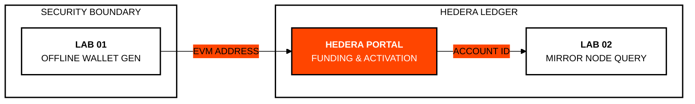

# Module 0: Setup and Initial Testing
## First Steps in the Hedera Ecosystem

> [!IMPORTANT]
> **OBJECTIVE:** Set up your development environment, create your first cryptographic identities, and understand the basic structure of a Testnet account.

---

## Module Map
Before building, we must ensure we have the necessary tools and resources.

| Lab | Topic | Description |
| :--- | :--- | :--- |
| **01** | **Wallet Generation** | Generating ECDSA keys offline and obtaining an EVM address. |
| **02** | **Balance Query** | Interaction with Mirror Nodes to verify funds. |
| **03** | **Unlimited Association** | Configuring the account to receive tokens automatically (HIP-23). |
| **04** | **Child Wallets** | Creating controlled accounts from a primary account. |
| **05** | **AWS KMS Signer** | Air-gapped cloud HSM asymmetric signing via AWS KMS SignCommand. |
| **06** | **OpenTelemetry APM** | Distributed tracing with W3C TraceContext headers & latency metrics. |

---

## Account Configuration Flow

---

## Key Concepts

### 1. Testnet vs. Mainnet
Hedera provides a free Testnet where you can obtain test HBAR to develop at no cost. Never use your Mainnet keys for these exercises.

### 2. Mirror Nodes
Unlike consensus nodes, Mirror Nodes store network history and allow for fast queries (like balances) without paying transaction fees.

### 3. Associations (HIP-23)
In Hedera, to receive a token, you must first "associate" with it. However, with **Unlimited Association**, you can configure your account to accept any new token automatically.

---

## Before You Run

Every lab runs from the course web page or with `node`. Your testnet account signs and pays fees; some labs also use the practice wallets `ACCOUNT_1` and `ACCOUNT_2` (create them in the web Wallets panel, or set them in `.env`). A lab with an entry under **Run first** reads what that earlier lab saved in `state.json`, so run them in that order.

| Lab | Run first | Practice wallets | Cost |
| :--- | :--- | :--- | :--- |
| **01** | — | — | free (no transactions are sent) |
| **02** | — | — | <0.1 ℏ (network fees only) |
| **03** | — | — | <0.1 ℏ (network fees only) |
| **04** | — | Yes | <0.1 ℏ (network fees only) |
| **05** | — | — | <0.1 ℏ (network fees only) |
| **06** | — | — | <0.1 ℏ (network fees only) |

---

## Official References
- [Hedera Developer Portal](https://portal.hedera.com/)
- [Mirror Node API Reference](https://docs.hedera.com/hedera/sdks-and-apis/rest-api)
- [HIP-23: Automatic Token Associations](https://hips.hedera.com/hip/hip-23)

---

 2026 **HEDERA FOR DUMMIES**. YOUR JOURNEY STARTS HERE.
