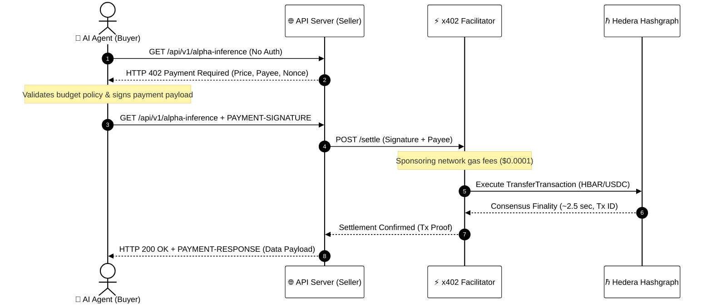
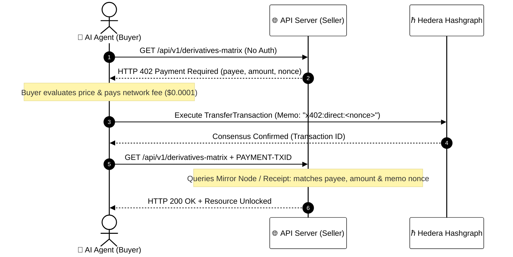

# ⚡ Module 10: Agentic Micropayments (x402 Protocol)
## Machine-to-Machine Autonomous Commerce on Hedera

> [!IMPORTANT]
> **OBJECTIVE:** Transform autonomous AI agents from mere analytical reasoning tools into economically sovereign entities capable of discovering, pricing, and settling on-chain micropayments per request via the HTTP 402 standard on Hedera.

---

## 🗺️ Module Map

In this module, we close the missing link between artificial intelligence and decentralized finance: autonomous micro-settlement without human intervention, credit cards, or API subscription paywalls.

| Lab | Topic | Description | Operational Architecture |
| :--- | :--- | :--- | :--- |
| **01** | **Server 402 Challenge** | Setting up a protected resource that issues standard HTTP 402 Payment Required challenges. | Foundation |
| **02** | **Agent Payment Signature** | Generating cryptographic payment intent proofs signed by autonomous agents. | Sponsored Facilitator |
| **03** | **Facilitator Settlement** | Sponsoring network fees and executing zero-gas on-chain settlement on Hedera. | Sponsored Facilitator |
| **04** | **HTS USDC Micropayments** | Settling fractional-cent per-call API requests in native stablecoins. | HTS Token Engine |
| **05** | **Financial Guardrails** | Enforcing autonomous spending ceilings, merchant allowlists, and circuit breakers. | Risk Governance |
| **06** | **Autonomous Market Agent** | Full end-to-end simulation of an AI agent dynamically querying and paying for external intelligence. | Autonomous Agent Loop |
| **07** | **Live AI Streaming Gateway** | Real-time Server-Sent Events (SSE) AI inference streaming gated by x402 on-chain micro-settlement. | Real-Time Proxy |
| **08** | **Direct P2P Settlement** | Autonomous Buyer & Seller 2-actor flow without facilitators, auditing on-chain txId with memo nonces. | Direct P2P (2 Actors) |

---

## 🔄 Dual Architectural Topologies

The official x402 standard on Hedera supports two operational topologies depending on the client's gas capabilities and decentralization requirements:

### Architecture 1: Sponsored Facilitator Pattern (3 Actors: Buyer + Seller + Facilitator)

Ideal for gasless AI agents, web frontends, or microservices that do not hold native HBAR for gas:

---

### Architecture 2: Direct P2P Pattern (2 Actors: Buyer + Seller)

Completely trustless and decentralized; eliminates any dependency on third-party facilitator infrastructure:

---

## ⚖️ Architectural Comparison: When to Use Which?

| Architectural Dimension | Direct P2P (Buyer + Seller) | Sponsored Facilitator (Buyer + Seller + Facilitator) |
| :--- | :--- | :--- |
| **Actor Model** | 2 Actors (Pure P2P) | 3 Actors (Buyer, Seller, Facilitator) |
| **Network Gas Responsibility** | Buyer pays network fee directly (~$0.0001) | Facilitator co-signs and sponsors network fee |
| **Client Balance Requirements** | Must hold HBAR for gas + asset to pay | Zero-gas client (only holds payment asset or authorization) |
| **Intermediary Dependency** | **Zero** (100% decentralized, no single point of failure) | Requires online Facilitator relayer |
| **Anti-Replay Mechanism** | Enforced by single-use challenge nonce in **Transaction Memo** | Enforced by signed payload nonce evaluated by Facilitator |
| **Best Used For** | High-sovereignty machine-to-machine, automated infrastructure | Consumer apps, gasless mobile agents, browser extensions |

---

## 📚 Official References
- [x402 on Hedera Documentation](https://docs.hedera.com/solutions/ai/x402)
- [How x402 Works (Architecture Spec)](https://docs.hedera.com/solutions/ai/x402/how-it-works)
- [x402 Foundation Protocol Repository](https://github.com/x402-foundation/x402)
- [Hedera Exact Payment Scheme Specification](https://github.com/x402-foundation/x402/blob/main/specs/schemes/exact/scheme_exact_hedera.md)
- [Blocky402 Open Source Facilitator](https://blocky402.com/)
- [Hedera Agent Kit](https://github.com/hedera-dev/hedera-agent-kit)

---

© 2026 **HEDERA FOR DUMMIES**. CODE IS CURRENCY. SETTLEMENT IS INSTANT.
