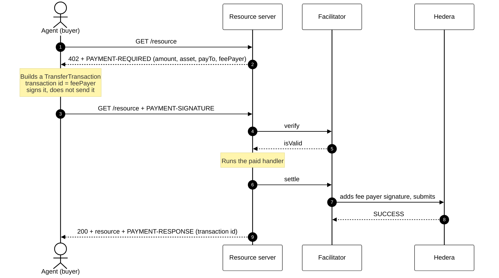

# Module 10: Agentic Micropayments (x402)
## Pay-per-request APIs for AI agents, settled on Hedera

> [!IMPORTANT]
> **OBJECTIVE:** Understand x402 end to end, then build with it: a paid API that answers HTTP 402, an agent that pays it without a human, and a facilitator that settles each payment on Hedera testnet. Every lab uses the official packages (`@x402/core`, `@x402/hedera`, `@x402/fetch`) and runs both in Node.js and in the course website.

---

## Module Map

| Lab | Topic | What you learn |
| :--- | :--- | :--- |
| **01** | **The HTTP 402 Payment Challenge** | Build a paid route and decode the `PAYMENT-REQUIRED` terms: amount, asset, payTo, feePayer. Free. |
| **02** | **The Agent Signs a Payment** | The payment is a `TransferTransaction` whose transaction id belongs to the fee payer, signed by the agent but not sent. The facilitator verifies it. Free. |
| **03** | **The Facilitator Settles on Hedera** | The full round trip over HTTP: verify, deliver, settle, `PAYMENT-RESPONSE`. Who pays what, and why a replay fails. |
| **04** | **Pricing in Dollars with an HTS Stablecoin** | Quote `"$0.01"`, settle in a 6-decimal HTS token (USDC, or the course's tUSD). Associations still apply. |
| **05** | **Spending Guardrails for Agents** | Spend caps, payee policies and a budget hook, all enforced before signing; an audit log on HCS. |
| **06** | **An Agent That Shops for Data** | Free 402 quotes from three providers, a score, one payment to the winner. |
| **07** | **Paying for an AI Stream in Batches** | x402 sells credits; a Server-Sent Events stream spends them; the agent buys again when they run out. |
| **08** | **Run Your Own Facilitator** | The facilitator as an HTTP service (`/supported`, `/verify`, `/settle`), hosted by the merchant, reached through `HTTPFacilitatorClient`. |

---

## The three roles

| Role | In these labs | Does | Pays |
| :--- | :--- | :--- | :--- |
| **Buyer** (agent) | `ACCOUNT_1` | Reads the 402, signs a transfer, retries the request | Only the price |
| **Resource server** (merchant) | `ACCOUNT_2` | Prices routes, asks the facilitator to verify and settle, delivers | Nothing (receives the price) |
| **Facilitator** | Your account (Lab 08: the merchant) | Verifies payments, co-signs as fee payer, submits to Hedera | The network fee |

## How a payment flows



---

## Key Concepts

### 1. The 402 is a machine-readable price tag
`PAYMENT-REQUIRED` is Base64 JSON (`x402Version: 2`). Each entry in `accepts` names a scheme (`exact`), a network (`hedera:testnet`), an asset (`0.0.0` for HBAR or an HTS token id), an integer `amount` in the asset's smallest unit, the `payTo` account and `extra.feePayer`.

### 2. The buyer signs, the facilitator submits
On Hedera the `exact` scheme is a partially signed `TransferTransaction`. Its transaction id uses the facilitator's account, so the facilitator pays the fee; the buyer needs no HBAR for gas. The facilitator refuses anything else: other operations, a fee payer that sends HBAR, transfers that do not match the terms.

### 3. Settlement and replay protection come from Hedera
The server only answers 200 after settlement succeeds, and the `PAYMENT-RESPONSE` header carries the Hedera transaction id as a receipt. A transaction id can execute once and is valid for about 120 seconds, so a replayed payment fails with `DUPLICATE_TRANSACTION` and a stale one expires. No nonce registry is needed.

### 4. Guardrails live in the buyer
Spend controls (allowed assets and a per-payment cap), policies (filters over the offers) and `onBeforePaymentCreation` hooks run before anything is signed. A buyer that trusts the server's terms is not protected.

### 5. Facilitators are interchangeable
A resource server talks to any facilitator through the same three calls. The labs run one in process (`createLocalFacilitator` in `M99_Utilities/x402.js`), Lab 08 serves it over HTTP, and `https://x402.org/facilitator` is a hosted one: set `X402_FACILITATOR_URL` in Lab 08 to use it.

---

## Before you run

```bash
# course/.env
OPERATOR_ID=0.0.x            # your account: the facilitator (pays network fees)
OPERATOR_PRIVATE_KEY=...
ACCOUNT_1_ID=0.0.y           # the agent (buyer)
ACCOUNT_1_PRIVATE_KEY=...
ACCOUNT_2_ID=0.0.z           # the merchant (payTo)
ACCOUNT_2_PRIVATE_KEY=...
```

On the course website, create the practice wallets in **Wallets** and every lab runs in the browser: the API servers and the facilitator run inside the page, and the payments are real testnet transactions. Prices are 0.01 ℏ or less and move between your own practice wallets.

## Official References
- https://docs.hedera.com/solutions/ai/x402
- https://docs.hedera.com/solutions/ai/x402/how-it-works
- https://docs.hedera.com/solutions/ai/x402/facilitators
- https://github.com/x402-foundation/x402/blob/main/specs/schemes/exact/scheme_exact_hedera.md
- https://www.npmjs.com/package/@x402/hedera
