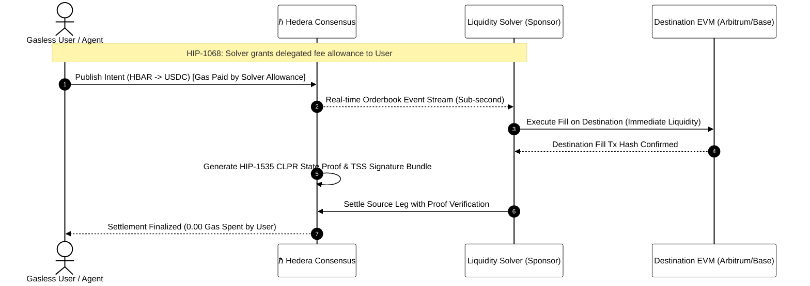

# Module 13: Cross-Ledger Protocol & Data Streams
## Bridgeless Interoperability, Fee Sponsorship, and Decentralized Block Lakes

> [!IMPORTANT]
> **OBJECTIVE:** Master Hedera's next-generation modular data architecture and cross-chain foundations: Eliminate bridge honeypots using the Linux Foundation Decentralized Trust Cross-Ledger Protocol (CLPR / HIP-1535), onboard zero-balance users gaslessly via Native Fee Sponsorship (HIP-1068), and ingest unified Block Streams verified by Threshold Signature Schemes (HIP-1056 / HIP-1081 / HIP-1137).

---

## Module Map

In this module, we transition from single-ledger dApp engineering into cross-chain modular infrastructure and high-throughput data lakes.

| Lab | Topic | Description | Teachable Moment |
| :--- | :--- | :--- | :--- |
| **01** | **CLPR State Proofs** | Constructing and verifying bridgeless cryptographic state proofs (HIP-1535). | The biggest Web3 hacks were bridge honeypots; CLPR replaces trust with mathematics. |
| **02** | **Sponsored Fees** | Delegating native fee allowances for zero-HBAR agents and users (HIP-1068). | True Web2-like onboarding: users never need to buy or bridge gas tokens upfront. |
| **03** | **Block Streams & TSS** | Ingesting unified block streams ratified by Threshold Signature Schemes (HIP-1056). | Aggregating validator signatures shrinks proof verification from O(N) to O(1). |
| **04** | **Block Node Lake** | Dynamic on-chain discovery (HIP-1137) and querying distributed block storage (HIP-1081). | Decoupling execution from long-term history prevents state bloat on consensus nodes. |
| **05** | **Intent Settlement Engine** | Full autonomous cross-chain liquidity routing and gasless settlement simulation. | Chain abstraction is achieved when users state intents and solvers compete on Hedera. |
| **06** | **Block Stream Protobuf Parser** | Binary Protobuf stream ingestion and fine-grained state change indexing from 2026 Block Nodes. | Eliminates smart contract re-execution; state mutations are emitted directly at memory speed. |

---

## The CLPR Bridgeless Cross-Chain Settlement Flow

---

## Key Concepts

### 1. Cross-Ledger Protocol (CLPR / HIP-1535)
Traditional cross-chain bridges require users to lock tokens in a smart contract monitored by an off-chain multisig committee. These contracts have become the multi-billion-dollar honeypots of crypto. Under **CLPR** (co-authored by Leemon Baird and Richard Bair in Linux Foundation Decentralized Trust), ledgers communicate using cryptographic state proofs and **Threshold Signature Schemes (TSS)**. A destination EVM contract verifies the inclusion proof directly, enabling bridgeless cross-chain operations.

### 2. Native Delegated Fee Sponsorship (HIP-1068)
In the Ethereum ecosystem, gas sponsorship requires ERC-4337 Account Abstraction, custom bundlers, Paymaster contracts, and alternate mempools. Hedera provides **native fee allowances directly at the consensus layer**. An enterprise, game developer, or AI agent sponsor can approve a fee allowance for an account with zero balance. The network debits the sponsor while the end-user enjoys instant, gasless execution.

### 3. Block Streams & Aggregated TSS Proofs (HIP-1056)
Hedera is migrating from individual node record streams (.rcd files) to a unified **Block Stream**. Every block contains canonical headers, transaction Merkle roots, state mutation roots, and an aggregated BLS/ECDSA threshold signature signed by the Hedera Council. This empowers lightweight verification for rollups, mobile clients, and cross-chain light clients.

### 4. Block Nodes & Data Lakes (HIP-1081 / HIP-1137)
To prevent state bloat, Hedera decouples high-speed transaction ordering from terabyte-scale historical storage. **Block Nodes** form a decentralized data lake storing raw block streams. **HIP-1137** introduces dynamic on-chain discovery via the consensus address book, allowing indexers, developers, and mirror nodes to discover healthy storage peers with low latency.

---

## Official References
- [HIP-1535: Cross-Ledger Protocol (CLPR), draft](https://hips.hedera.com/hip/hip-1535)
- [HIP-1068: Native Delegated Fee Allowances](https://github.com/hashgraph/hedera-improvement-proposals/blob/main/HIP/hip-1068.md)
- [HIP-1056: Unified Block Streams](https://github.com/hashgraph/hedera-improvement-proposals/blob/main/HIP/hip-1056.md)
- [HIP-1081: Block Node Architecture](https://github.com/hashgraph/hedera-improvement-proposals/blob/main/HIP/hip-1081.md)
- [HIP-1137: Dynamic Block Node Discovery](https://github.com/hashgraph/hedera-improvement-proposals/blob/main/HIP/hip-1137.md)
- [Linux Foundation Decentralized Trust (LFDT)](https://www.lfdecentralizedtrust.org/)

---

 2026 **HEDERA FOR DUMMIES**. BRIDGES ARE DEAD. PROOFS ARE FOREVER.
