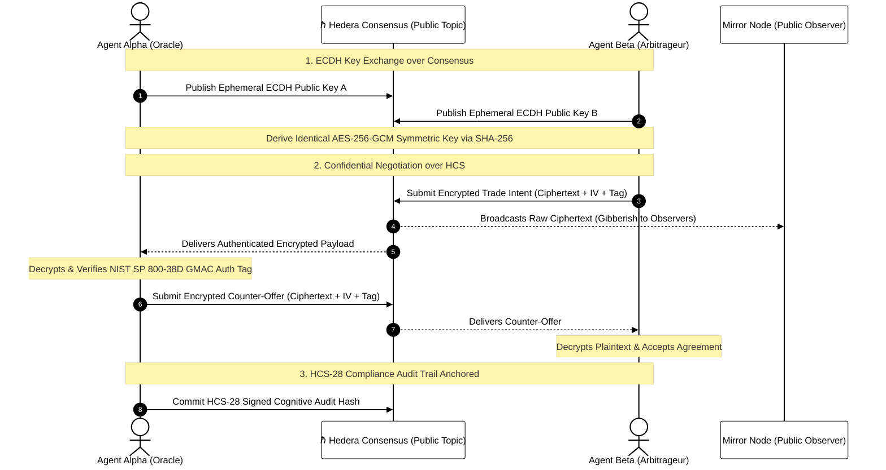

# Module 14: Advanced HCS Standards & Autonomous AI
## Inscriptions, Trust Scores, Agent Skills, Merkle Logs, and Encrypted Swarms

> [!IMPORTANT]
> **OBJECTIVE:** Master the advanced open standards emerging from Hashgraph Online and the Hedera AI ecosystem: Inscribe high-throughput auditable points (HCS-20), calculate decentralized portable AI trust scores (HCS-25), discover machine capabilities permissionlessly (HCS-26), anchor scalable Merkle transparency checkpoints (HCS-27), enforce cognitive provenance (HCS-28), and conduct confidential, end-to-end encrypted agent swarm negotiations over public consensus.

---

## Module Map

In this module, we transition Hedera Consensus Service from a simple message queue into a global decentralized operating system for autonomous machine intelligence.

| Lab | Topic | Description | Teachable Moment |
| :--- | :--- | :--- | :--- |
| **01** | **HCS-20 Auditable Points** | High-throughput inscriptive balance accounting without smart contracts. | Event-sourcing over consensus eliminates EVM state-bloat and provides sub-cent accounting. |
| **02** | **HCS-25 AI Trust Score** | Multi-dimensional reputation vectors (uptime, consensus proofs, feedback). | Web2 AI reputation is opaque; on Hedera, an agent's creditworthiness is a mathematical fact. |
| **03** | **HCS-26 Agent Skills Registry** | Decentralized MCP tool manifests and semantic agent capability discovery. | Eliminating proprietary plugin app stores prevents platform deplatforming and censorship. |
| **04** | **HCS-27 Merkle Transparency** | Committing off-chain Merkle tree checkpoints with inclusion proofs. | Batching 10,000 operations into a single HCS Merkle root cuts gas costs by 99.99%. |
| **05** | **HCS-28 Cognitive Audit Trail** | Cryptographically signed reasoning traces and policy compliance logs. | When AI models manage real capital, immutable provenance separates liability from compliance. |
| **06** | **Encrypted Swarm Chat** | Confidential P2P OTC agent negotiations using ECDH and AES-256-GCM over HCS. | Consensus gives you fair ordering; client-side cryptography gives you military-grade confidentiality. |
| **07** | **HCS-15..18 Botanical Swarm** | Petal sub-accounts (HCS-15), peer discovery (HCS-18), multi-sig Floras (HCS-16) & state hashes (HCS-17). | Separating communication, transaction scheduling, and state checkpoints lets swarms scale securely. |
| **08** | **HCS-12 HashLinks & HCS-21** | Actionable on-chain UI micro-apps (HCS-12) backed by SHA-256 verified adapters (HCS-21). | Combining on-chain UI assemblies with package digests prevents both phishing and supply-chain attacks. |
| **09** | **HIP-1334 Private Message Box** | Spec-compliant setup (memos, signed HIP-1334_PUBLIC_KEY first message), proof verification and ECIES messages on HCS. | The signed first message stops front-running of the public key. |
| **10** | **Hedera MCP Server with a Policy Guard** | Real stdio MCP server (@modelcontextprotocol/sdk) exposing Hedera tools behind a custom policy guard. | Keys and policy live in the server; the AI only sees tools. |

---

## The Encrypted Autonomous Agent Swarm Architecture

---

## Key Concepts

### 1. Inscription-Based Accounting (HCS-20)
Traditional tokens require EVM contract state storage or HTS token associations for each recipient. **HCS-20** introduces deterministic JSON inscription semantics directly into consensus messages. By ordering `deploy`, `mint`, `transfer`, and `burn` events with sub-second timestamps, indexers compute user balances deterministically off-chain with zero contract vulnerability.

### 2. Portable Machine Reputation (HCS-25)
Autonomous AI agents need a decentralized credit score. If an agent hallucinates parameters or defaults on a debt, protocols need to detect it immediately. **HCS-25** establishes a multi-dimensional reputation vector calculated from: (1) cryptographic heartbeat uptime proofs, (2) on-chain deterministic execution accuracy, and (3) cryptographically signed human feedback.

### 3. Open Agent Skill Manifests (HCS-26)
Walled-garden AI plugin directories (such as proprietary app stores) create censorship bottlenecks. **HCS-26** allows any agent to broadcast its Model Context Protocol (MCP) tool manifests, OpenAPI schemas, and per-call pricing models directly to an HCS topic. Peer agents query the topic, filter by semantic tags, and invoke tools autonomously.

### 4. Scalable Merkle Checkpoints (HCS-27)
High-frequency automated systems (such as high-frequency trading bots or IoT telemetry sensors) generate millions of operations. Submitting each one individually is cost-prohibitive. **HCS-27** groups operations into an off-chain Merkle tree and commits only the periodic Merkle root to HCS. Any participant can verify an individual operation using a compact logarithmic Merkle inclusion proof.

### 5. Verifiable Cognitive Flight Recorder (HCS-28)
When AI models interact with real capital, questions of liability arise. **HCS-28** anchors an agent's complete reasoning trace—including prompt hashes, chain-of-thought summaries, tool invocation parameters, and guardrail clearances—signed by the agent's private key. This prevents developers or agents from altering history after a failure.

### 6. Confidential Agent Swarms (ECDH + AES-256-GCM)
Public ledgers provide transparency and ordering, but leak confidential business strategies. By executing an **Elliptic Curve Diffie-Hellman (ECDH)** key exchange directly through an open HCS topic, two agents establish a shared symmetric secret and communicate using **AES-256-GCM** authenticated encryption. The public consensus layer guarantees sequencing and tamper-resistance, while observers on the Mirror Node see only cryptographically undecipherable ciphertext.

---

## Official References
- [Hashgraph Online Standards Registry](https://standards.hashgraphonline.com/)
- [HCS-20 Specification: Inscriptions & Auditable Points](https://docs.hashgraphonline.com/hcs-20)
- [HCS-25 Specification: AI Trust Score Methodology](https://docs.hashgraphonline.com/hcs-25)
- [HCS-26 Specification: Decentralized Agent Skills Registry](https://docs.hashgraphonline.com/hcs-26)
- [HCS-27 Specification: Transparency Log Checkpoints](https://docs.hashgraphonline.com/hcs-27)
- [HCS-28 Specification: Agent Audit Stream](https://docs.hashgraphonline.com/hcs-28)
- [Hedera Consensus Service Developer Guide](https://docs.hedera.com/hedera/sdks-and-apis/sdks/consensus-service)

---

 2026 **HEDERA FOR DUMMIES**. MACHINES NEED TRUST. TRUST NEEDS HASHGRAPH.
