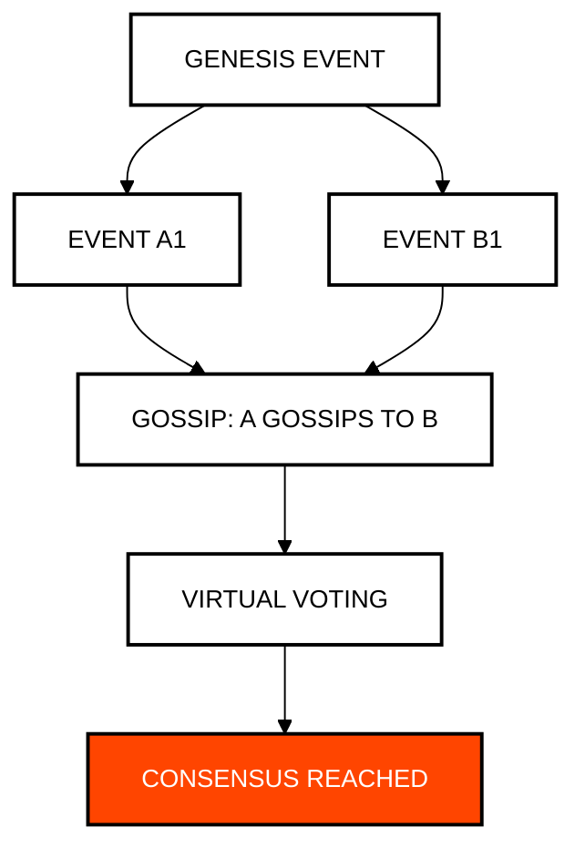

# Module 1: Fundamentals and Cryptography
## Consensus Architecture and Digital Sovereignty

> [!IMPORTANT]
> **OBJECTIVE:** Understand why Hedera is not a blockchain and how industrial-grade cryptography secures the network.

---

## Module Map
This module covers the pillars of the Hedera network: from the Hashgraph algorithm to key management.

| Lab | Topic | Description |
| :--- | :--- | :--- |
| **01** | **aBFT Consensus** | Simulation of Gossip-about-Gossip and Virtual Voting. |
| **02** | **Account Rent** | The economic model of on-chain storage. |
| **03** | **KMS Cryptography** | Signing real transactions with a non-extractable WebCrypto key, the same signWith pattern a KMS or HSM uses. |
| **04** | **Key Rotation** | How to change account security without changing its ID. |
| **05** | **Lazy Account Creation** | Auto-creating Hedera accounts by transferring HBAR to an EVM alias (HIP-583). |
| **06** | **Native Staking** | Delegating HBAR stake to consensus nodes for network security and rewards (HIP-406). |
| **07** | **Simple Fees Engine** | Deterministic fee modeling (Node, Network, Service) and exchange rate conversion (HIP-1261). |
| **08** | **HBAR Allowances (HIP-336)** | HBAR allowances (HIP-336): the spender moves the sponsor's HBAR without the sponsor's key. |

---

## The Hashgraph Algorithm (Gossip-about-Gossip)

Unlike traditional blockchains, Hedera uses a DAG (Directed Acyclic Graph) to reach consensus asynchronously.

---

## Key Concepts

### 1. Gossip-about-Gossip
Nodes share not only transactions but also the history of who they have talked to. This creates an immutable record of information propagation.

### 2. Virtual Voting
Thanks to the shared history (DAG), each node can predict how others would vote without needing to send physical votes across the network, saving bandwidth and time.

### 3. Account Rent (Storage Rent)
In Hedera, storage is not free forever. Accounts must pay a small rent fee to remain active, preventing network state bloat.

---

## Before You Run

Every lab runs from the course web page or with `node`. Your testnet account signs and pays fees; some labs also use the practice wallets `ACCOUNT_1` and `ACCOUNT_2` (create them in the web Wallets panel, or set them in `.env`). A lab with an entry under **Run first** reads what that earlier lab saved in `state.json`, so run them in that order.

| Lab | Run first | Practice wallets | Cost |
| :--- | :--- | :--- | :--- |
| **01** | — | — | free (no transactions are sent) |
| **02** | — | Yes | <0.1 ℏ (network fees only) |
| **03** | — | — | <1 ℏ (account creation and network fees; the 0.2 ℏ deposit comes back) |
| **04** | — | Yes | <0.1 ℏ (network fees only) |
| **05** | — | — | ~1 ℏ (network fees only) |
| **06** | — | — | <0.1 ℏ (network fees only) |
| **07** | — | — | <0.1 ℏ (network fees only) |
| **08** | — | — | <1 ℏ |

---

## Official References
- [Hedera Hashgraph Whitepaper](https://hedera.com/whitepaper)
- [Account Documentation (Hedera Docs)](https://docs.hedera.com/hedera/networks/mainnet/account-rent)
- [Cryptography Standards (HIP-32)](https://hips.hedera.com/hip/hip-32)

---

 2026 **HEDERA FOR DUMMIES**. DESIGNED FOR RESILIENCE.
