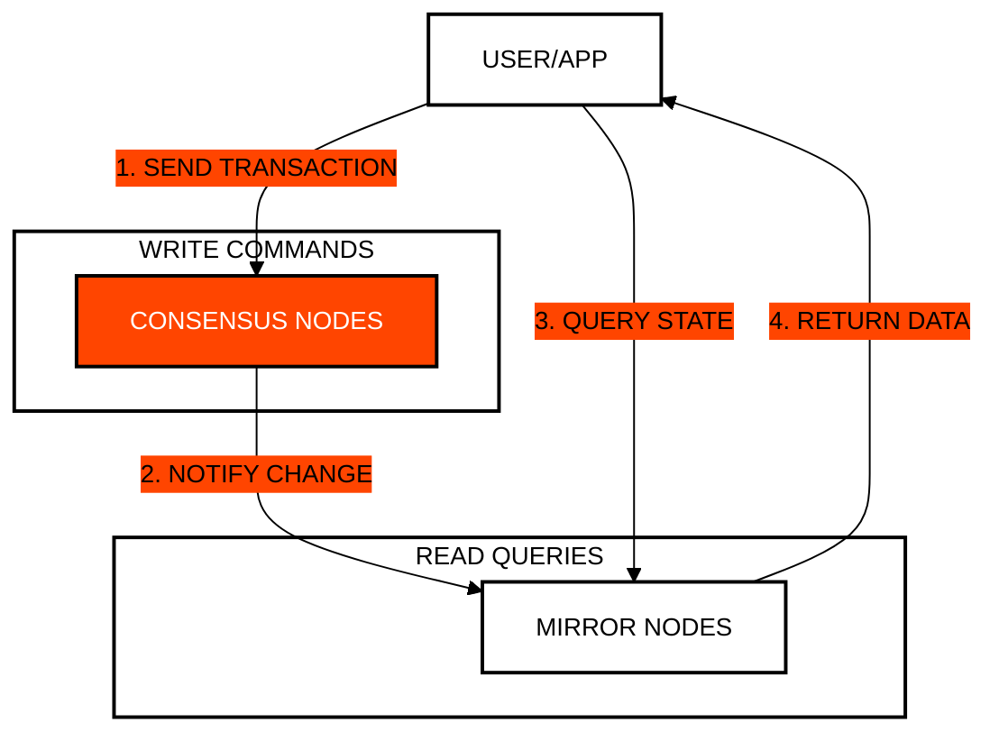

# Module 2: State Interrogation and CQRS
## Efficient and Scalable Network Queries

> [!IMPORTANT]
> **OBJECTIVE:** Learn to separate write operations (Consensus) from read operations (Mirror Nodes) using the CQRS pattern to maximize performance.

---

## Module Map

| Lab | Topic | Description |
| :--- | :--- | :--- |
| **01** | **Sync Deprecation** | Why querying state directly from consensus nodes is costly and inefficient. |
| **02** | **Secure REST API** | How to perform asynchronous queries to Mirror Nodes securely. |
| **03** | **Recursive Pagination** | Handling large data volumes by using "next links". |
| **04** | **Event Sourcing Reactor** | Ingesting mirror streams into an embedded in-memory SQLite CQRS read-model with sub-ms queries. |
| **05** | **Circuit Breaker** | Resilient fault tolerance, backoff jitter, and cache failover against Mirror Node rate limits. |
| **06** | **WebSocket Event Bus** | Push-based reactive WebSocket/SSE stream gateway for live ledger transactions. |
| **07** | **GraphQL Subgraph** | Unified graph query engine eliminating REST cascades with single-roundtrip resolvers. |

---

## The CQRS Pattern in Hedera

In Hedera, the ideal architecture separates the responsibilities of commands (state changes) and queries (state reading).

---

## Key Concepts

### 1. Why Avoid Synchronous Queries?
Querying a consensus node requires it to stop its primary work (validating transactions) to respond. This is expensive (higher fees) and does not scale.

### 2. Mirror Nodes (The Read Layer)
Mirror Nodes receive a copy of all confirmed transactions. They are ideal for low-latency queries, data analysis, and history, and are generally free or low-cost.

### 3. Pagination and Recursion
When you request a long list (e.g., all tokens for an account), the Mirror Node returns a fragment and a link to the next one (`next`). Learning to follow these links recursively is vital for production applications.

---

## Before You Run

Every lab runs from the course web page or with `node`. Your testnet account signs and pays fees; some labs also use the practice wallets `ACCOUNT_1` and `ACCOUNT_2` (create them in the web Wallets panel, or set them in `.env`). A lab with an entry under **Run first** reads what that earlier lab saved in `state.json`, so run them in that order.

| Lab | Run first | Practice wallets | Cost |
| :--- | :--- | :--- | :--- |
| **01** | — | — | <0.1 ℏ (network fees only) |
| **02** | — | — | <0.1 ℏ (network fees only) |
| **03** | — | — | <0.1 ℏ (network fees only) |
| **04** | — | — | <0.1 ℏ (network fees only) |
| **05** | — | — | <0.1 ℏ (network fees only) |
| **06** | — | — | <0.1 ℏ (network fees only) |
| **07** | — | — | <0.1 ℏ (network fees only) |

---

## Official References
- [Mirror Node API Documentation](https://mainnet-public.mirrornode.hedera.com/api/v1/docs/)
- [CQRS Pattern in Distributed Architectures](https://martinfowler.com/bliki/CQRS.html)
- [Hedera Mirror Node Architecture](https://docs.hedera.com/hedera/core-concepts/mirror-nodes)

---

 2026 **HEDERA FOR DUMMIES**. SCALE WITHOUT LIMITS.
