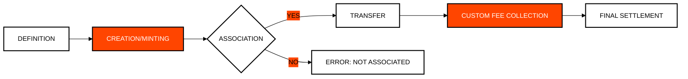

# Module 3: Hedera Token Service (HTS)
## Native Tokenization with Database Performance

> [!IMPORTANT]
> **OBJECTIVE:** Create and manage digital assets (fungible tokens and NFTs) directly at the consensus layer, without the complexity or risks of traditional smart contracts.

---

## Module Map

| Lab | Topic | Description |
| :--- | :--- | :--- |
| **01** | **Fungible Token Issuance** | Creating a fungible token and choosing which keys (admin, supply, pause) to keep. |
| **02** | **Financial Identity** | Using KYC and Freeze keys for regulatory compliance. |
| **03** | **NFTs and HIP-412** | Creating NFTs following the community metadata standard. |
| **04** | **On-Chain Resolution** | Querying token metadata and states from Mirror Nodes. |
| **05** | **Custom Fees** | Configuring fixed and fractional transfer fees at the protocol level. |
| **06** | **Base Layer Royalties** | Implementing automated royalties at the base layer. |
| **07** | **Dynamic NFTs (HIP-657)** | Mutating on-chain NFT metadata dynamically using the Metadata Key. |
| **08** | **HIP-412 Metadata Schema** | Constructing and validating rich multi-file JSON schemas for NFTs. |
| **09** | **Treasury Supply-Key Lock (HIP-850)** | Updating NFT metadata in Treasury with SupplyKey and locking upon holder delivery. |
| **10** | **Rarity Inspector & Airdrop Verifier** | Creator tools for statistical trait rarity scoring, HIP-412 compliance, and verified airdrops. |

---

## Token Lifecycle in HTS

---

## Key Concepts

### 1. Native Tokens vs. Smart Contracts
In Hedera, tokens are first-class citizens. This means transfer and balance logic is integrated into the nodes, making them 1,000 times faster and cheaper than an ERC-20 on Ethereum.

### 2. HIP-412 Standard
For NFTs to display correctly in wallets and marketplaces, they must follow a specific metadata structure (JSON on IPFS or HCS). HIP-412 is the gold standard for this.

### 3. Custom Fees
Hedera allows you to define collection rules at the protocol level. You can configure it so that every time a token changes hands, a portion is automatically sent to the creator (Royalties) or a fixed fee is sent to the treasury.

---

## Before You Run

Every lab runs from the course web page or with `node`. Your testnet account signs and pays fees; some labs also use the practice wallets `ACCOUNT_1` and `ACCOUNT_2` (create them in the web Wallets panel, or set them in `.env`). A lab with an entry under **Run first** reads what that earlier lab saved in `state.json`, so run them in that order.

| Lab | Run first | Practice wallets | Cost |
| :--- | :--- | :--- | :--- |
| **01** | — | — | ~15 ℏ the first time (it creates a token, about 1 USD); <0.1 ℏ when you run it again (it reuses what it created) |
| **02** | — | Yes | ~15 ℏ the first time (it creates a token, about 1 USD); <1 ℏ when you run it again (it reuses what it created) |
| **03** | — | — | ~25 ℏ the first time (it creates a token and uploads a file, about 1.4 USD); ~9 ℏ when you run it again (it reuses what it created) |
| **04** | M3 Lab 03 | — | <0.1 ℏ (network fees only) |
| **05** | — | Yes | ~30 ℏ the first time (it creates a token with custom fees, about 2 USD); <1 ℏ when you run it again (it reuses what it created) |
| **06** | — | Yes | ~30 ℏ the first time (it creates a token with custom fees, about 2 USD); ~1.5 ℏ when you run it again (the buyer account and fees) |
| **07** | — | — | ~15 ℏ the first time (it creates a token, about 1 USD); <1 ℏ when you run it again (it reuses what it created) |
| **08** | — | — | ~15 ℏ the first time (it creates a token, about 1 USD); <1 ℏ when you run it again (it reuses what it created) |
| **09** | — | — | ~15 ℏ each run (it creates a token, about 1 USD) |
| **10** | — | Yes | ~15 ℏ the first time (it creates a token, about 1 USD); <1 ℏ when you run it again (it reuses what it created) |

---

## Official References
- [Hedera Token Service (HTS) Overview](https://docs.hedera.com/hedera/core-concepts/tokens)
- [HIP-412: NFT Metadata JSON Schema](https://hips.hedera.com/hip/hip-412)
- [Token Custom Fees Documentation](https://docs.hedera.com/hedera/networks/mainnet/custom-fees)

---

 2026 **HEDERA FOR DUMMIES**. REAL TOKENIZATION.
