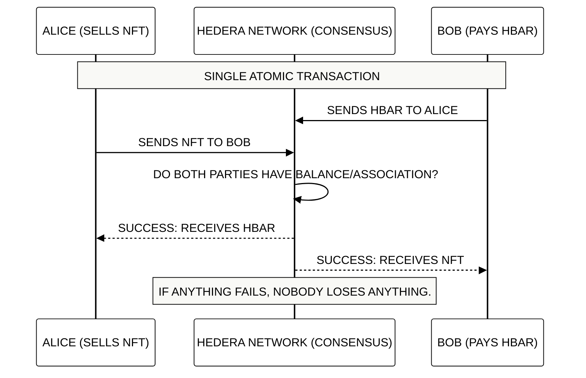

# Module 4: Token Operations and Atomic Swaps
## Trustless Trade and Transfer Efficiency

> [!IMPORTANT]
> **OBJECTIVE:** Master the movement of assets on the network, from simple transfers to complex multi-party exchanges where "everything happens or nothing happens" (Atomicity).

---

## Module Map

| Lab | Topic | Description |
| :--- | :--- | :--- |
| **01** | **HBAR Transfers** | Basic sending of the native currency between accounts. |
| **02** | **Token Transfers** | Movement of fungible tokens (HTS). |
| **03** | **NFT Transfers** | Exchange of unique assets between collectors. |
| **04** | **Atomic Swaps** | The "Holy Grail" of trade: asset exchange without intermediaries. |
| **05** | **Parallel Transfers** | Network optimization by sending multiple movements in a single batch. |
| **06** | **Native Token Airdrops** | Frictionless token distribution with pending claim queues (HIP-904). |
| **07** | **Airdrop Cancel & Token Reject** | Clawing back unclaimed pending airdrops and rejecting spam tokens fee-free (HIP-904). |
| **08** | **Triangular L1 Clearing** | In-memory Coincidence of Wants (CoW) matching engine settling 3-way ring trades atomically. |
| **09** | **Atomic Flash Settlement** | Four real testnet accounts settle borrow, buy, sell and repay (HBAR + an HTS token) in one multi-signed TransferTransaction; an unfunded attempt is rejected as a whole. |

---

## The Atomic Swap

In Hedera, you can include up to 10 transfers in a single transaction. If a single one fails (e.g., due to insufficient balance), the ENTIRE transaction is reverted.

---

## Key Concepts

### 1. Atomicity (All-or-Nothing)
Atomicity eliminates counterparty risk. You don't need an "escrow" or a trusted third party; the network itself guarantees that the exchange is simultaneous.

### 2. Network Efficiency
A single transaction can move HBAR, Fungible Tokens, and NFTs at the same time. This reduces fees and network congestion compared to making multiple separate transactions.

### 3. Transfer Limits
Each transfer transaction in Hedera has a limit of "transfer points" (usually 10). This allows for great flexibility for complex payments or mass distributions (Airdrops).

---

## Before You Run

Every lab runs from the course web page or with `node`. Your testnet account signs and pays fees; some labs also use the practice wallets `ACCOUNT_1` and `ACCOUNT_2` (create them in the web Wallets panel, or set them in `.env`). A lab with an entry under **Run first** reads what that earlier lab saved in `state.json`, so run them in that order.

| Lab | Run first | Practice wallets | Cost |
| :--- | :--- | :--- | :--- |
| **01** | — | Yes | ~1 ℏ (network fees only) |
| **02** | M3 Lab 01 | Yes | <0.1 ℏ (network fees only) |
| **03** | M3 Lab 03 | Yes | <0.1 ℏ (network fees only) |
| **04** | M3 Lab 03 | Yes | <0.1 ℏ (network fees only) |
| **05** | — | Yes | <1 ℏ (network fees only) |
| **06** | — | — | ~15 ℏ the first time (it creates a token, about 1 USD); ~2 ℏ when you run it again (it reuses what it created) |
| **07** | — | — | ~15 ℏ the first time (it creates a token, about 1 USD); ~3 ℏ when you run it again (it reuses what it created) |
| **08** | — | — | ~35 ℏ the first time (it creates 2 tokens, about 2 USD); ~6 ℏ when you run it again (it reuses what it created) |
| **09** | — | — | ~17 ℏ (FLASH token creation ~15 ℏ on testnet) + ~0.6 ℏ to throwaway accounts + fees |

---

## Official References
- [Transfer Transactions (Hedera Docs)](https://docs.hedera.com/hedera/sdks-and-apis/sdks/transactions/transfer-tokens)
- [Understanding Atomicity in DLT](https://hedera.com/learning/hedera-hashgraph/what-is-atomicity)
- [Token Transfer Limits and Fees](https://docs.hedera.com/hedera/networks/mainnet/fees)

---

 2026 **HEDERA FOR DUMMIES**. SECURE TRADE.
