# Module 5: Hedera Consensus Service (HCS)
## Decentralized Trust for Arbitrary Data

> [!IMPORTANT]
> **OBJECTIVE:** Use Hedera as a "Trust Layer" to order and timestamp any message or data without needing to store it in the main network state.

---

## Module Map

| Lab | Topic | Description |
| :--- | :--- | :--- |
| **01** | **Immutable Topics** | Creating persistent communication channels (Topics). |
| **02** | **Data Standards** | Structuring messages in JSON for interoperability. |
| **03** | **Chunking** | Sending large messages split into automatic segments. |
| **04** | **HCS Ping-Pong** | Simulating bidirectional communication between agents. |
| **05** | **HCS-6 Registry** | Dynamic on-chain service and dApp discovery using HCS-6 topics. |
| **06** | **Paid Topics (HIP-991)** | Monetizing HCS topics with custom fixed fees in HBAR or HTS tokens. |
| **07** | **Merkle Batch Ingestion** | High-throughput in-memory event batcher committing Keccak-256 Merkle roots with O(log N) proofs. |
| **08** | **Kafka Streaming Bridge** | High-throughput enterprise event stream bridge anchoring partition watermarks to HCS. |

---

## Messaging Flow in HCS

HCS does not store message content permanently on consensus nodes; it only guarantees order and validity. Mirror Nodes handle persistence for subscribers.

```mermaid
%%{init: {
  'theme': 'base',
  'themeVariables': {
    'primaryColor': '#ffffff',
    'primaryTextColor': '#000000',
    'primaryBorderColor': '#000000',
    'lineColor': '#000000',
    'secondaryColor': '#FF4500',
    'tertiaryColor': '#ffffff',
    'mainBkg': '#ffffff',
    'nodeBorder': '#000000',
    'clusterBkg': '#F9F9F6',
    'clusterBorder': '#000000',
    'fontSize': '14px',
    'fontFamily': 'Inter, system-ui, -apple-system, sans-serif',
    'nodeRadius': '0px'
  }
}}%%
graph LR
    A[SENDER] -->|1. SEND MESSAGE| B[HEDERA TOPIC]
    B -->|2. ORDER AND TIMESTAMP| C[CONSENSUS NODES]
    C -->|3. NOTIFY| D[MIRROR NODES]
    D -->|4. BROADCAST| E[SUBSCRIBER/APP]
    
    %% Styling
    classDef default fill:#ffffff,stroke:#000000,stroke-width:2px;
    classDef accent fill:#FF4500,stroke:#000000,stroke-width:2px,color:#ffffff;
    
    class B default;
    class C accent;
    class D default;
```

---

## Key Concepts

### 1. Topics
A Topic is like a cryptographic chat channel. It can be public (anyone can read/write) or private (requires signing keys to send messages).

### 2. Consensus Timestamp
Each message in HCS receives a unique "Consensus Timestamp."This allows for the creation of unforgeable audit logs where exactly when an event occurred in relation to all others is known.

### 3. Chunking
The size limit of a message in Hedera is 1024 bytes. To send larger files or data, the SDK allows for fragmenting the message into multiple parts that the subscriber can reconstruct automatically.

---

## Official References
- [Hedera Consensus Service (HCS) Whitepaper](https://hedera.com/consensus-service)
- [Working with Topics and Messages](https://docs.hedera.com/native/consensus)
- [HCS Message Chunking Logic](https://docs.hedera.com/hedera/sdks-and-apis/sdks/consensus-service/submit-a-message)

---

 2026 **HEDERA FOR DUMMIES**. THE TRUTH IS DECENTRALIZED.
