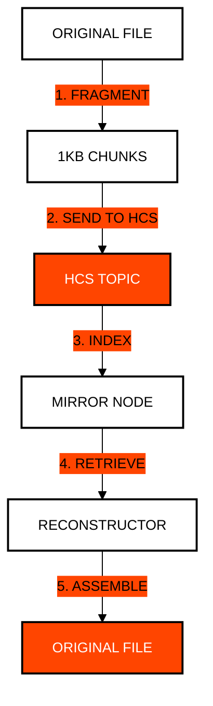

# Module 6: Mass Storage and Hashinals
## Immutable Data at Global Scale

> [!IMPORTANT]
> **OBJECTIVE:** Learn to store large files and complex metadata using a combination of HFS (File Service) and the HCS-1 standard to create "Hashinals."

---

## Module Map

| Lab | Topic | Description |
| :--- | :--- | :--- |
| **01** | **Native HFS** | Creating and reading small files in the Hedera File Service. |
| **02** | **Large File HFS** | Handling size limits by appending data to existing files. |
| **03** | **Batch Uploading** | Optimizing the upload of multiple assets in a single bundle. |
| **04** | **Economic HCS-1** | Atomic data storage using HCS Topics for low-cost persistence. |
| **05** | **HCS-1 Reconstruction** | Retrieving and assembling fragmented data from Mirror Nodes. |
| **06** | **Dynamic Hashinals (HCS-6)** | An NFT that evolves: its metadata points at an HCS-6 registry whose latest entry is the current version. |
| **07** | **HCS-1 Native NFT** | Creating a fully decentralized NFT with metadata and image stored on HCS. |
| **08** | **HCS-1 NFT Reconstruction** | Retrieving and assembling an NFT entirely from Mirror Node shards. |
| **09** | **HCS-7 Smart Hashinals** | A dynamic NFT resolved like a wallet: live HBAR price from a contract, a WASM router inscribed with HCS-1, two variants (`hol.org`). |
| **10** | **Zero-Trust Encrypted Vault** | Gzip + AES-KW + AES-256-GCM envelope encryption, stored and read back as an HCS-1 file. |

---

## HCS-1 Architecture (Hashinals)

Unlike HFS, HCS-1 fragments a file and injects it into an HCS Topic. This is more economical and allows for total immutability without the need for admin keys.

---

## Key Concepts

### 1. Hedera File Service (HFS)
HFS acts like a traditional file system on the network. It is ideal for files that need to be updated or require specific administrative permissions.

### 2. Hashinals (HCS-1)
Hashinals are Hedera's answer to Bitcoin "Ordinals."They use the consensus service to inscribe data permanently. It is the most economical method for storing large volumes of immutable data.

### 3. Economic Immutability
While storing 1GB on a traditional blockchain can cost thousands of dollars, the strategic use of HCS-1 and compression allows these costs to be drastically reduced while maintaining the security of Hedera's consensus.

---

## The hcs:// Standard (Recursive NFT)

The `hcs://` protocol is a community-driven URI format that enables recursive asset resolution. Instead of pointing to a CID (IPFS) or a URL, the NFT points to an HCS Topic.

**Pointer Format:** `hcs://<TOPIC_ID>?fid=<METADATA_FID>`

1. **Resolution**: The client fetches all messages from the Topic.
2. **Reconstruction**: It filters messages by `fid` (File Identity) to rebuild the JSON metadata.
3. **Recursive Step**: The metadata itself contains another `hcs://` pointer to the binary asset (image/video).
4. **Final Assembly**: The client reconstructs the binary asset on-the-fly.

---

## Before You Run

Every lab runs from the course web page or with `node`. Your testnet account signs and pays fees; some labs also use the practice wallets `ACCOUNT_1` and `ACCOUNT_2` (create them in the web Wallets panel, or set them in `.env`). A lab with an entry under **Run first** reads what that earlier lab saved in `state.json`, so run them in that order.

| Lab | Run first | Practice wallets | Cost |
| :--- | :--- | :--- | :--- |
| **01** | — | — | ~5 ℏ each run (it uploads a file, about 0.3 USD) |
| **02** | — | — | ~15 ℏ each run (it uploads a file, about 1.2 USD) |
| **03** | M6 Lab 01 | — | ~9 ℏ each run (it uploads a file, about 0.5 USD) |
| **04** | — | — | <1 ℏ (network fees only) |
| **05** | M6 Lab 04 | — | free (Mirror Node reads only) |
| **06** | — | — | ~15 ℏ the first time (it creates a token, about 1 USD); <1 ℏ when you run it again (it reuses what it created) |
| **07** | — | — | ~15 ℏ the first time (it creates a token, about 1 USD); ~3 ℏ when you run it again (it reuses what it created) |
| **08** | M6 Lab 07 | — | free (Mirror Node reads only) |
| **09** | — | — | ~15 ℏ the first time (it deploys the price-feed contract, about 1 USD); ~1 ℏ when you run it again (it reuses the contract and the inscriptions) |
| **10** | — | — | <1 ℏ (network fees only) |

---

## Official References
- [Hedera File Service (HFS) Guide](https://docs.hedera.com/hedera/core-concepts/file-service)
- [HCS-1: Atomic Storage Standard](https://hashinals.com/)
- [Cost Comparison: HFS vs HCS Storage](https://hedera.com/fees)

---

 2026 **HEDERA FOR DUMMIES**. DATA IS FOREVER.
