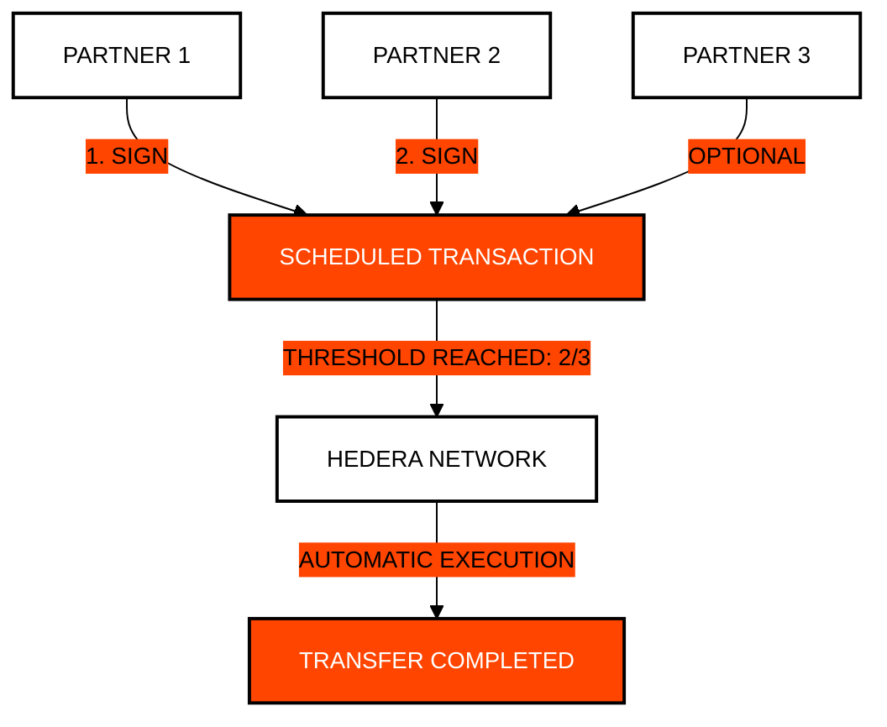

# ⚖️ Module 7: Governance and Automation (Cron)
## Multi-signature Control and Decentralized Orchestration

> [!IMPORTANT]
> **OBJECTIVE:** Implement advanced security models using multi-signature accounts and automate future transactions using the native scheduled transactions service.

---

## 🗺️ Module Map

| Lab | Topic | Description |
| :--- | :--- | :--- |
| **01** | **Multisig KeyList** | Creating accounts that require multiple signatures (Threshold Keys). |
| **02** | **Multisig Transfer** | Executing asset movements that depend on the approval of several partners. |
| **03** | **Native Cron** | Scheduling transactions for automatic execution in the future. |
| **04** | **Decoupled Orchestration** | Separating business logic from network execution. |
| **05** | **Decentralized Identity** | Creating DID documents for identity sovereignty. |
| **06** | **DID Login** | Cryptographic identity verification without passwords. |
| **07** | **Autonomous Treasury DAO** | Webhook-driven reactive multisig orchestration and layer-1 scheduled quorum execution. |
| **08** | **Timelock Governance Controller** | 48-hour timelock execution windows and emergency cryptographic veto on Hedera Schedule Service. |

---

## 🔐 Multi-signature Governance (Threshold)

In Hedera, you can define that an account requires, for example, 2 out of 3 signatures to move funds. This eliminates single points of failure.

---

## 🔑 Key Concepts

### 1. Signature Thresholds (Threshold Keys)
Unlike a complex smart contract, Hedera allows you to define key lists with thresholds directly on the account. It is more secure, cheaper, and easier to audit.

### 2. Scheduled Transactions
This feature allows you to "freeze" a transaction on the network until conditions (such as necessary signatures) are met or until a specific time arrives. It is the native "Cron Job" of Web3.

### 3. DID (Decentralized Identity)
Using HCS, we can anchor identity metadata that allows users to prove who they are without relying on a centralized database like Google or Facebook.

---

## 📚 Official References
- [Multi-signature Accounts (Hedera Docs)](https://docs.hedera.com/hedera/core-concepts/keys-and-signatures#multi-signature-signing)
- [Scheduled Transactions Documentation](https://docs.hedera.com/hedera/sdks-and-apis/sdks/scheduled-transactions)
- [W3C Decentralized Identifiers (DID) Standard](https://www.w3.org/TR/did-core/)

---

© 2026 **HEDERA FOR DUMMIES**. POWER IS SHARED.
