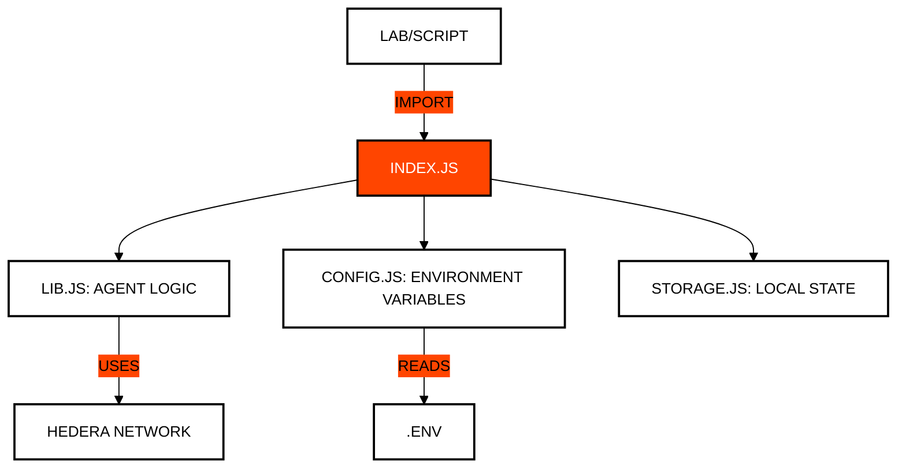

# 🛠️ Module 99: Utilities and Helpers
## The Developer's Toolbox

> [!IMPORTANT]
> **GOAL:** Centralize repetitive functions, configuration management, and network utilities to maintain clean and modular code throughout the course.

---

## 🗺️ Module Map

| File | Purpose | Description |
| :--- | :--- | :--- |
| **lib.js** | **Core Library** | Shared functions for HCS communication, signatures, and key management. |
| **config.js** | **Env Management**| Loading and validating variables from the `.env` file. |
| **storage.js** | **Local Persistence**| State management in JSON files (`state.json`). |
| **transfer.js** | **Sending Engines** | Simplification of complex HBAR and token transfers. |
| **explorer.js** | **Audit Links**| Generation of direct links to HashScan for verification. |

---

## 🏗️ Utility Integration

All lessons in the course depend on this module to interact with the Hedera network in a standardized way.

---

## 🔑 Key Concepts

### 1. DRY (Don't Repeat Yourself)
Instead of writing Hedera connection logic in every file, we centralize it here. This makes maintenance easier: if the SDK changes, we only update one file.

### 2. State Management (`state.json`)
To make labs progressive, we need to save account IDs or tokens created in previous steps. `storage.js` handles this persistence transparently.

### 3. Communication Abstraction
The `AgentCommunicationHandler` class in `lib.js` abstracts the complexity of Mirror Node subscriptions and message filtering, allowing labs to focus on AI logic.

---

## 📚 Official References
- [Clean Code Principles](https://blog.cleancoder.com/uncle-bob/2012/08/13/the-clean-architecture.html)
- [Node.js File System (fs) API](https://nodejs.org/api/fs.html)
- [Hiero SDK for JavaScript](https://github.com/hashgraph/hedera-sdk-js)

---

© 2026 **HEDERA PARA DUMMIES**. CLEAN CODE, CLEAN MIND.
