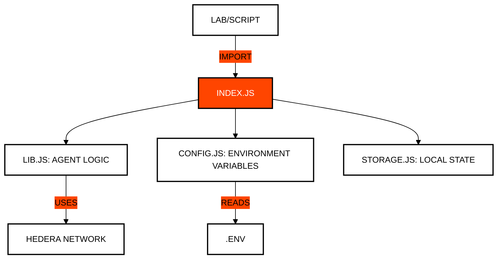

# Module 99: Utilities and Helpers
## The Developer's Toolbox

> [!IMPORTANT]
> **GOAL:** Centralize repetitive functions, configuration management, and network utilities to maintain clean and modular code throughout the course.

---

## Module Map

| File | Purpose | Description |
| :--- | :--- | :--- |
| **lib.js** | **Core Library** | Shared functions for HCS communication, signatures, and key management. |
| **config.js** | **Env Management**| Loads `.env`, validates credentials and builds clients (`getClient`, `createClient`) with a generous fee ceiling. |
| **storage.js** | **Local Persistence**| `updateState`/`getState`: per-module `state.json` plus a course-wide `state.json`, written atomically. |
| **resilience.js** | **Network Resilience**| `withGasRetry`/`executeWithGas`, `waitForMirror`, `getAccountEvmAddress`, `ensureFunded`, `getJsonRpcSigner`. |
| **transfer.js** | **Sending Engines** | Simplification of complex HBAR and token transfers. |
| **explorer.js** | **Audit Links**| Generation of direct links to HashScan for verification. |

---

## Writing Labs That Keep Working

Fees, gas costs and Mirror Node timing change over time. Labs stay reliable when they use these helpers instead of fixed numbers:

| Problem | Use | Why |
| :--- | :--- | :--- |
| `INSUFFICIENT_TX_FEE` | `getClient()` / `createClient()` | Clients come with a 100 ℏ fee ceiling (`MAX_TRANSACTION_FEE_HBAR`). Only the real fee is charged. Avoid `setMaxTransactionFee` with small values. |
| `INSUFFICIENT_GAS` | `executeWithGas((gas) => tx.setGas(gas), client, { gas })`, `withGasRetry` for queries | Retries with double the gas, up to the 15M limit. |
| Data not on the Mirror Node yet | `waitForMirror(async () => …)` | The Mirror Node shows new data a few seconds after consensus. |
| A secondary account pays | `ensureFunded(client, accountId, minHbar)` | Tops it up from the operator before it runs out. |
| EVM address of an account | `getAccountEvmAddress(accountId)` | Returns the alias or long-zero address the network actually uses. |
| ethers / JSON-RPC relay | `getJsonRpcSigner(client, operatorKey)` | The relay only maps ECDSA alias accounts; creates one once if needed. |
| State from another module | `getState(key)` | Reads the module's `state.json`, then the course-wide one, then `.env`. |

Every lab ends the same way: a printed `` failure sets `process.exitCode = 1`, and the entry block exits so no lab hangs.

---

## Utility Integration

All lessons in the course depend on this module to interact with the Hedera network in a standardized way.

---

## Key Concepts

### 1. DRY (Don't Repeat Yourself)
Instead of writing Hedera connection logic in every file, we centralize it here. This makes maintenance easier: if the SDK changes, we only update one file.

### 2. State Management (`state.json`)
To make labs progressive, we need to save account IDs or tokens created in previous steps. `storage.js` handles this persistence transparently.

### 3. Communication Abstraction
The `AgentCommunicationHandler` class in `lib.js` abstracts the complexity of Mirror Node subscriptions and message filtering, allowing labs to focus on AI logic.

---

## Official References
- [Clean Code Principles](https://blog.cleancoder.com/uncle-bob/2012/08/13/the-clean-architecture.html)
- [Node.js File System (fs) API](https://nodejs.org/api/fs.html)
- [Hiero SDK for JavaScript](https://github.com/hashgraph/hedera-sdk-js)

---

 2026 **HEDERA PARA DUMMIES**. CLEAN CODE, CLEAN MIND.
