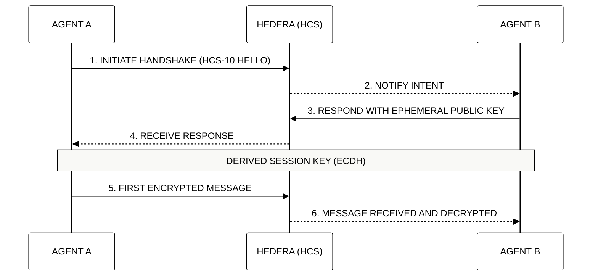

# 🤖 Module 9: The Agentic AI Economy
## Atomic Protocol Orchestration and Autonomous Trade

> [!IMPORTANT]
> **OBJECTIVE:** Transition from reactive Large Language Models (LLMs) to autonomous and economically independent agentic swarms using Hedera communication standards.

---

## 🗺️ Atomic Curriculum Map
This module focuses on the communication and sovereignty of AI agents.

| Lab | Topic | Description |
| :--- | :--- | :--- |
| **01** | **HCS-1 File Storage** | Anchoring heavy payloads (agent configs, assets) in topics with the HCS-1 file standard. |
| **02** | **HCS-2 Topic Registries** | Turning a topic into a machine-readable directory ("yellow pages") of agent endpoints. |
| **03** | **HCS-2 Registry Discovery** | Rebuilding a local, searchable index from the registry's message stream. |
| **04** | **HCS-11 AI Profiles** | Provisioning three agents with accounts, inbound/outbound topics and HCS-11 profiles. |
| **05** | **HCS-14 Universal Agent ID** | Deterministic, offline identifiers (UAID) for the agents created in Lab 04. |
| **06** | **User-to-Agent (HCS-10)** | A person and an agent talking in real time over public HCS-10 topics. |
| **07** | **Agent-to-Agent (HCS-10)** | Two autonomous agents running a stateful ping-pong over their topics. |
| **08** | **Impersonation Attack** | Why public streams alone are unsafe: a spoofer agent injects forged messages. |
| **09** | **Secure A2A** | Zero-trust validation: signed payloads plus sequence numbers against replay. |
| **10** | **Secure A2A under Attack** | The same protocol holding up while an attacker floods forged and replayed packets. |
| **11** | **Encrypted A2A** | Private agent messages over a public ledger with hybrid RSA-OAEP + AES-GCM encryption. |

---

## 🔐 Agent Handshake (HCS-10)

Before two agents exchange sensitive data, they must perform a "Handshake" to verify identities and agree on a session key.

---

## 🔑 Key Concepts

### 1. UAID (Universal Agent ID)
In the agentic economy, identity is the first layer of trust. The **HCS-14** standard provides a unique global identifier that persists across different networks and environments, allowing an agent to maintain its reputation.

### 2. Privacy by Design (Hybrid Encryption)
Although Hedera is a public ledger, agents can communicate privately. We use **RSA** for secure key exchange and **AES-256-GCM** for high-speed data encryption, ensuring that only the intended recipient can read the content.

### 3. Autonomous Orchestration
Unlike traditional bots, Hedera agents can make economic decisions, pay for their own resources (gas, storage), and charge for their services without human intervention.

---

## 📚 Official References
- [HCS-10: OpenConvAI Standard](https://github.com/hashgraphonline/standards)
- [HCS-14: Universal Agent ID (UAID)](https://github.com/hashgraphonline/standards)
- [Hybrid Encryption Best Practices (NIST)](https://csrc.nist.gov/publications/detail/sp/800-56b/rev-2/final)

---

© 2026 **HEDERA FOR DUMMIES**. AGENTIC INDEPENDENCE.
