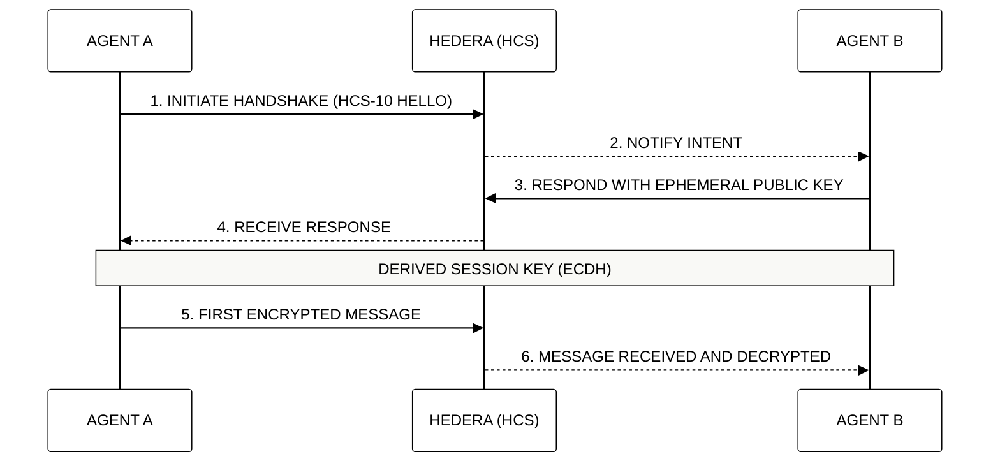

# 🤖 Module 9: The Agentic AI Economy
## Atomic Protocol Orchestration and Autonomous Trade

> [!IMPORTANT]
> **OBJECTIVE:** Transition from reactive Large Language Models (LLMs) to autonomous and economically independent agentic swarms using Hedera communication standards.

---

## 🗺️ Atomic Curriculum Map
This module focuses on the communication and sovereignty of AI agents.

| Lab | Topic | Focus |
| :--- | :--- | :--- |
| **01-03** | **Identity and Profiling** | HCS-11 and HCS-14 (UAID) for verifiable identities. |
| **04-05** | **Secure Handshake** | HCS-10 protocol for establishing secure sessions. |
| **06-07** | **Public Messaging** | Auditable open communication on the ledger. |
| **08-10** | **Defense and Attack** | Simulation of impersonation attacks and active defense. |
| **11** | **Hybrid Encryption** | Private A2A communication using RSA + AES. |

---

## 🔐 Agent Handshake (HCS-10)

Before two agents exchange sensitive data, they must perform a "Handshake" to verify identities and agree on a session key.

---

## 🔑 Key Concepts

### 1. UAID (Universal Agent ID)
In the agentic economy, identity is the first layer of trust. The **HCS-14** standard provides a unique global identifier that persists across different networks and environments, allowing an agent to maintain its reputation.

### 2. Privacy by Design (Hybrid Encryption)
Although Hedera is a public ledger, agents can communicate privately. We use **RSA** for secure key exchange and **AES-256-GCM** for high-speed data encryption, ensuring that only the intended recipient can read the content.

### 3. Autonomous Orchestration
Unlike traditional bots, Hedera agents can make economic decisions, pay for their own resources (gas, storage), and charge for their services without human intervention.

---

## 📚 Official References
- [HCS-10: OpenConvAI Standard](https://github.com/hashgraphonline/standards)
- [HCS-14: Universal Agent ID (UAID)](https://github.com/hashgraphonline/standards)
- [Hybrid Encryption Best Practices (NIST)](https://csrc.nist.gov/publications/detail/sp/800-56b/rev-2/final)

---

© 2026 **HEDERA FOR DUMMIES**. AGENTIC INDEPENDENCE.
