# Módulo 0: Configuración y Pruebas Iniciales
## Primeros Pasos en el Ecosistema Hedera

> [!IMPORTANT]
> **OBJETIVO:** Configurar tu entorno de desarrollo, crear tus primeras identidades criptográficas y entender la estructura básica de una cuenta en la Testnet.

---

## Mapa del Módulo
Antes de construir, debemos asegurar que tenemos las herramientas y los recursos necesarios.

| Lab | Tema | Descripción |
| :--- | :--- | :--- |
| **01** | **Generación de Billetera** | Creación de claves ECDSA y cuenta en la Testnet. |
| **02** | **Consulta de Saldo** | Interacción con Mirror Nodes para verificar fondos. |
| **03** | **Asociación Ilimitada** | Configuración de la cuenta para recibir tokens automáticamente (HIP-23). |
| **04** | **Billeteras Hijas** | Creación de cuentas controladas por una cuenta principal. |
| **05** | **Firmador AWS KMS** | Custodia institucional y firma asimétrica air-gapped con AWS KMS SignCommand. |
| **06** | **OpenTelemetry APM** | Trazabilidad distribuida con cabeceras W3C TraceContext y métricas de latencia. |

---

## Flujo de Configuración de Cuenta

```mermaid
%%{init: {
  'theme': 'base',
  'themeVariables': {
    'primaryColor': '#ffffff',
    'primaryTextColor': '#000000',
    'primaryBorderColor': '#000000',
    'lineColor': '#000000',
    'secondaryColor': '#FF4500',
    'tertiaryColor': '#ffffff',
    'mainBkg': '#ffffff',
    'nodeBorder': '#000000',
    'clusterBkg': '#F9F9F6',
    'clusterBorder': '#000000',
    'fontSize': '14px',
    'fontFamily': 'Inter, system-ui, -apple-system, sans-serif',
    'nodeRadius': '0px'
  }
}}%%
graph LR
    A[PORTAL HEDERA] --> B[OBTENER TESTNET ID/KEY]
    B --> C[SCRIPT 01: CREAR BILLETERA]
    C --> D[MIRROR NODE]
    D --> E[SCRIPT 02: VERIFICAR SALDO]
    
    %% Styling
    classDef default fill:#ffffff,stroke:#000000,stroke-width:2px;
    classDef accent fill:#FF4500,stroke:#000000,stroke-width:2px,color:#ffffff;
    
    class A default;
    class C accent;
    class E default;
```

---

## Conceptos Clave

### 1. Testnet vs Mainnet
Hedera proporciona una Testnet gratuita donde puedes obtener HBAR de prueba para desarrollar sin costo. Nunca uses tus claves de Mainnet para estos ejercicios.

### 2. Mirror Nodes
A diferencia de los nodos de consenso, los Mirror Nodes almacenan el historial de la red y permiten consultas rápidas (como el saldo) sin pagar tarifas de transacción.

### 3. Asociaciones (HIP-23)
En Hedera, para recibir un token, primero debes "asociarte" a él. Sin embargo, con la **Asociación Ilimitada**, puedes configurar tu cuenta para que acepte cualquier token nuevo automáticamente.

---

## Referencias Oficiales
- [Hedera Developer Portal](https://portal.hedera.com/)
- [Mirror Node API Reference](https://docs.hedera.com/hedera/sdks-and-apis/rest-api)
- [HIP-23: Automatic Token Associations](https://hips.hedera.com/hip/hip-23)

---

 2026 **HEDERA PARA DUMMIES**. TU VIAJE COMIENZA AQUÍ.
