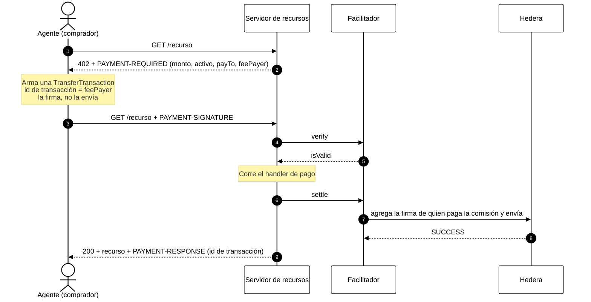

# Módulo 10: Micropagos Agénticos (x402)
## APIs de pago por petición para agentes de IA, liquidadas en Hedera

> [!IMPORTANT]
> **OBJETIVO:** Entender x402 de punta a punta y construir con él: una API de pago que responde HTTP 402, un agente que la paga sin intervención humana y un facilitador que liquida cada pago en Hedera testnet. Todos los labs usan los paquetes oficiales (`@x402/core`, `@x402/hedera`, `@x402/fetch`) y corren tanto en Node.js como en la web del curso.

---

## Mapa del Módulo

| Lab | Tema | Qué aprendes |
| :--- | :--- | :--- |
| **01** | **El Desafío de Pago HTTP 402** | Construir una ruta de pago y decodificar las condiciones de `PAYMENT-REQUIRED`: monto, activo, payTo, feePayer. Gratis. |
| **02** | **El Agente Firma un Pago** | El pago es una `TransferTransaction` cuyo id de transacción pertenece a quien paga la comisión, firmada por el agente pero no enviada. El facilitador la verifica. Gratis. |
| **03** | **El Facilitador Liquida en Hedera** | El ciclo completo por HTTP: verificar, entregar, liquidar, `PAYMENT-RESPONSE`. Quién paga qué y por qué falla una repetición. |
| **04** | **Precios en Dólares con una Stablecoin HTS** | Cotizar `"$0.01"` y liquidar en un token HTS de 6 decimales (USDC o el tUSD del curso). Las asociaciones siguen aplicando. |
| **05** | **Límites de Gasto para Agentes** | Topes de gasto, políticas de receptor y un hook de presupuesto, todo aplicado antes de firmar; registro de auditoría en HCS. |
| **06** | **Un Agente que Compra Datos** | Cotizaciones 402 gratuitas de tres proveedores, un puntaje y un solo pago al ganador. |
| **07** | **Pagar un Stream de IA por Lotes** | x402 vende créditos; un stream de Server-Sent Events los gasta; el agente vuelve a comprar cuando se acaban. |
| **08** | **Tu Propio Facilitador** | El facilitador como servicio HTTP (`/supported`, `/verify`, `/settle`), alojado por el comercio y usado mediante `HTTPFacilitatorClient`. |

---

## Los tres papeles

| Papel | En estos labs | Hace | Paga |
| :--- | :--- | :--- | :--- |
| **Comprador** (agente) | `ACCOUNT_1` | Lee el 402, firma una transferencia y repite la petición | Solo el precio |
| **Servidor de recursos** (comercio) | `ACCOUNT_2` | Pone precio a las rutas, pide al facilitador que verifique y liquide, entrega | Nada (recibe el precio) |
| **Facilitador** | Tu cuenta (Lab 08: el comercio) | Verifica pagos, firma como quien paga la comisión, los envía a Hedera | La comisión de red |

## Cómo fluye un pago



---

## Conceptos Clave

### 1. El 402 es una etiqueta de precio legible por máquinas
`PAYMENT-REQUIRED` es JSON en Base64 (`x402Version: 2`). Cada entrada de `accepts` indica un esquema (`exact`), una red (`hedera:testnet`), un activo (`0.0.0` para HBAR o el id de un token HTS), un `amount` entero en la unidad más pequeña del activo, la cuenta `payTo` y `extra.feePayer`.

### 2. El comprador firma, el facilitador envía
En Hedera, el esquema `exact` es una `TransferTransaction` parcialmente firmada. Su id de transacción usa la cuenta del facilitador, así que el facilitador paga la comisión; el comprador no necesita HBAR para gas. El facilitador rechaza cualquier otra cosa: otras operaciones, un feePayer que envía HBAR, transferencias que no coinciden con las condiciones.

### 3. La liquidación y la protección contra repeticiones vienen de Hedera
El servidor solo responde 200 cuando la liquidación tuvo éxito, y la cabecera `PAYMENT-RESPONSE` lleva el id de la transacción de Hedera como recibo. Un id de transacción se ejecuta una sola vez y es válido unos 120 segundos, así que un pago repetido falla con `DUPLICATE_TRANSACTION` y uno viejo caduca. No hace falta un registro de nonces.

### 4. Los límites viven en el comprador
Los controles de gasto (activos permitidos y tope por pago), las políticas (filtros sobre las ofertas) y los hooks `onBeforePaymentCreation` corren antes de firmar nada. Un comprador que confía en las condiciones del servidor no está protegido.

### 5. Los facilitadores son intercambiables
Un servidor de recursos habla con cualquier facilitador mediante las mismas tres llamadas. Los labs corren uno dentro del proceso (`createLocalFacilitator` en `M99_Utilities/x402.js`), el Lab 08 lo sirve por HTTP, y `https://x402.org/facilitator` es uno alojado: define `X402_FACILITATOR_URL` en el Lab 08 para usarlo.

---

## Antes de ejecutar

```bash
# course/.env
OPERATOR_ID=0.0.x            # tu cuenta: el facilitador (paga las comisiones de red)
OPERATOR_PRIVATE_KEY=...
ACCOUNT_1_ID=0.0.y           # el agente (comprador)
ACCOUNT_1_PRIVATE_KEY=...
ACCOUNT_2_ID=0.0.z           # el comercio (payTo)
ACCOUNT_2_PRIVATE_KEY=...
```

En la web del curso, crea las wallets de práctica en **Wallets** y cada lab corre en el navegador: los servidores de la API y el facilitador corren dentro de la página, y los pagos son transacciones reales de testnet. Los precios son de 0.01 ℏ o menos y se mueven entre tus propias wallets de práctica.

## Referencias Oficiales
- https://docs.hedera.com/solutions/ai/x402
- https://docs.hedera.com/solutions/ai/x402/how-it-works
- https://docs.hedera.com/solutions/ai/x402/facilitators
- https://github.com/x402-foundation/x402/blob/main/specs/schemes/exact/scheme_exact_hedera.md
- https://www.npmjs.com/package/@x402/hedera
