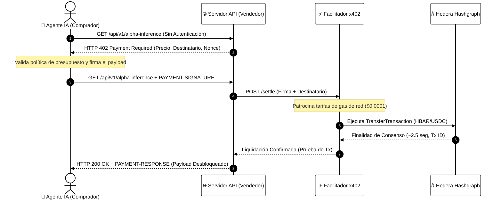
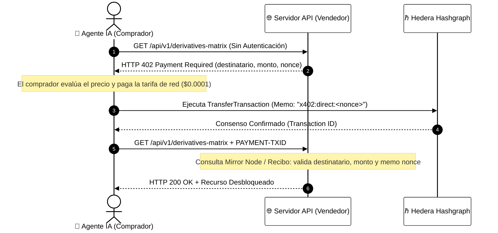

# ⚡ Módulo 10: Micropagos Agénticos (Protocolo x402)
## Comercio Autónomo Máquina a Máquina en Hedera

> [!IMPORTANT]
> **OBJETIVO:** Transformar a los agentes autónomos de IA de simples herramientas analíticas a entidades económicamente soberanas capaces de descubrir, cotizar y liquidar micropagos en cadena por solicitud mediante el estándar HTTP 402 en Hedera.

---

## 🗺️ Mapa del Módulo

En este módulo cerramos el eslabón perdido entre la inteligencia artificial y las finanzas descentralizadas: micro-liquidación autónoma sin intervención humana, tarjetas de crédito ni muros de pago por suscripción.

| Lab | Tema | Descripción | Arquitectura Operativa |
| :--- | :--- | :--- | :--- |
| **01** | **Desafío 402 del Servidor** | Configuración de un recurso protegido que emite desafíos estándar HTTP 402. | Fundación |
| **02** | **Firma de Pago del Agente** | Generación de pruebas de intención de pago firmadas criptográficamente por agentes. | Facilitador Patrocinado |
| **03** | **Liquidación con Facilitador** | Patrocinio de tarifas de red y liquidación en cadena sin gas en Hedera. | Facilitador Patrocinado |
| **04** | **Micropagos HTS en USDC** | Liquidación de peticiones API de fracciones de centavo en stablecoins nativas. | Motor de Tokens HTS |
| **05** | **Límites de Seguridad Financiera** | Aplicación de techos de gasto, listas blancas de comerciantes y disyuntores. | Gobernanza de Riesgo |
| **06** | **Agente de Mercado Autónomo** | Simulación completa de un agente de IA cotizando y pagando por inteligencia externa. | Bucle de Agente Autónomo |
| **07** | **Pasarela de Streaming de IA en Vivo** | Streaming de inferencia en tiempo real (SSE) protegido por micro-liquidación en cadena. | Proxy en Tiempo Real |
| **08** | **Liquidación Directa P2P** | Flujo autónomo de 2 actores (Comprador y Vendedor) sin intermediarios ni facilitadores. | Directo P2P (2 Actores) |

---

## 🔄 Topologías Arquitectónicas Duales

El estándar oficial x402 en Hedera admite dos topologías operativas según las capacidades de gas del cliente y los requisitos de descentralización:

### Arquitectura 1: Patrón con Facilitador Patrocinado (3 Actores: Comprador + Vendedor + Facilitador)

Ideal para agentes de IA sin gas, interfaces web o microservicios que no mantienen balance nativo de HBAR:

---

### Arquitectura 2: Patrón Directo P2P (2 Actores: Comprador + Vendedor)

Completamente descentralizado y sin confianza; elimina cualquier dependencia de servidores facilitadores de terceros:

---

## ⚖️ Comparación Arquitectónica: ¿Cuándo usar cada una?

| Dimensión Arquitectónica | Directo P2P (Comprador + Vendedor) | Facilitador Patrocinado (Comprador + Vendedor + Facilitador) |
| :--- | :--- | :--- |
| **Modelo de Actores** | 2 Actores (P2P Puro) | 3 Actores (Comprador, Vendedor, Facilitador) |
| **Responsabilidad del Gas** | El Comprador paga directamente la tarifa de red (~$0.0001) | El Facilitador co-firma y patrocina la tarifa de red |
| **Requisitos de Saldo del Cliente** | Debe poseer HBAR para gas + activo a pagar | Cliente sin gas (solo posee el activo o autorización) |
| **Dependencia de Intermediarios** | **Cero** (100% descentralizado, sin punto único de falla) | Requiere un relé Facilitador en línea |
| **Mecanismo Anti-Repetición** | Asegurado por el nonce del desafío en la **Memo de la Transacción** | Asegurado por el nonce en el payload firmado verificado por el Facilitador |
| **Casos de Uso Ideales** | Infraestructura crítica máquina a máquina, alta soberanía | Apps de consumo, agentes móviles sin gas, extensiones de navegador |

---

## 📚 Referencias Oficiales
- [Documentación de x402 en Hedera](https://docs.hedera.com/solutions/ai/x402)
- [Cómo Funciona x402 (Especificación de Arquitectura)](https://docs.hedera.com/solutions/ai/x402/how-it-works)
- [Repositorio del Protocolo de la Fundación x402](https://github.com/x402-foundation/x402)
- [Especificación del Esquema Exacto de Hedera](https://github.com/x402-foundation/x402/blob/main/specs/schemes/exact/scheme_exact_hedera.md)
- [Facilitador de Código Abierto Blocky402](https://blocky402.com/)
- [Hedera Agent Kit](https://github.com/hedera-dev/hedera-agent-kit)

---

© 2026 **HEDERA FOR DUMMIES**. EL CÓDIGO ES MONEDA. LA LIQUIDACIÓN ES INSTANTÁNEA.
