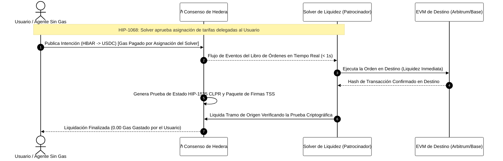

# Módulo 13: Protocolo Cross-Ledger y Flujos de Datos
## Interoperabilidad Sin Puentes, Patrocinio de Tarifas y Lagos de Bloques Descentralizados

> [!IMPORTANT]
> **OBJETIVO:** Dominar la arquitectura modular de datos de última generación de Hedera y sus fundamentos cross-chain: Eliminar los puentes vulnerables utilizando el Protocolo Cross-Ledger de Linux Foundation Decentralized Trust (CLPR / HIP-1535), incorporar usuarios con balance cero sin pagar gas mediante Patrocinio Nativo de Tarifas (HIP-1068), e ingerir Flujos de Bloques unificados verificados por Esquemas de Firma Umbral (HIP-1056 / HIP-1081 / HIP-1137).

---

## Mapa del Módulo

En este módulo, trascendemos la ingeniería de dApps en un solo ledger hacia infraestructura modular cross-chain y lagos de datos de alto rendimiento.

| Lab | Tema | Descripción | Momento de Aprendizaje |
| :--- | :--- | :--- | :--- |
| **01** | **Pruebas de Estado CLPR** | Construcción y verificación de pruebas criptográficas de estado sin puentes (HIP-1535). | Los mayores robos en Web3 fueron puentes multi-firma; CLPR sustituye la confianza por matemáticas. |
| **02** | **Tarifas Patrocinadas** | Delegación de asignaciones de tarifas nativas para agentes y usuarios con 0 HBAR (HIP-1068). | Incorporación estilo Web2: los usuarios jamás necesitan comprar o puentear tokens de gas previamente. |
| **03** | **Block Streams y TSS** | Ingesta de flujos de bloques unificados ratificados por firmas umbral agregadas (HIP-1056). | Agregar firmas de validadores reduce la verificación de pruebas de O(N) a O(1). |
| **04** | **Lago de Block Nodes** | Descubrimiento dinámico on-chain (HIP-1137) y consulta a almacenamiento distribuido (HIP-1081). | Desacoplar la ejecución del historial a largo plazo previene la saturación del consenso. |
| **05** | **Motor de Intenciones** | Simulación completa de enrutamiento autónomo de liquidez cross-chain y liquidación sin gas. | La abstracción de cadena se logra cuando los usuarios declaran intenciones y los solvers compiten. |
| **06** | **Parser Protobuf de Flujo de Bloques** | Ingesta binaria en streaming de Protobuf e indexación de mutaciones de estado desde Nodos de Bloque 2026. | Elimina la reejecución de smart contracts; las mutaciones de estado se emiten directamente a velocidad de memoria. |

---

## Flujo de Liquidación Cross-Chain Sin Puentes CLPR

---

## Conceptos Clave

### 1. Protocolo Cross-Ledger (CLPR / HIP-1535)
Los puentes cross-chain tradicionales obligan a los usuarios a depositar fondos en un contrato inteligente vigilado por un comité multi-firma off-chain. Estos depósitos se han convertido en los blancos favoritos de los atacantes en Web3. Con **CLPR** (co-diseñado por Leemon Baird y Richard Bair en Linux Foundation Decentralized Trust), los ledgers se comunican utilizando pruebas de inclusión criptográfica y **Esquemas de Firma Umbral (TSS)**. Un contrato inteligente en la cadena de destino verifica la prueba matemáticamente, eliminando la necesidad de puentes de custodia.

### 2. Patrocinio Nativo de Tarifas Delegadas (HIP-1068)
En Ethereum, patrocinar gas requiere abstracción de cuentas ERC-4337, contratos paymaster y mempools secundarios. Hedera implementa **asignaciones de tarifas nativas directamente a nivel de consenso**. Una empresa, desarrollador de videojuegos o patrocinador de agentes de IA puede autorizar una asignación para cuentas con balance de cero HBAR. La red debita al patrocinador mientras el usuario final experimenta una ejecución instantánea y sin fricciones.

### 3. Flujos de Bloques y Firmas TSS Agregadas (HIP-1056)
Hedera evoluciona desde archivos de registro individuales (.rcd) hacia un **Block Stream** unificado. Cada bloque consolida encabezados canónicos, raíces de transacciones Merkle, mutaciones de estado y una firma umbral BLS/ECDSA agregada ratificada por el Consejo de Hedera. Esto hace viable la verificación ligera para rollups, smartphones y clientes de sincronización rápida.

### 4. Block Nodes y Lagos de Datos (HIP-1081 / HIP-1137)
Para evitar la saturación de los validadores, Hedera desacopla el ordenamiento rápido de transacciones del almacenamiento histórico masivo. Los **Block Nodes** conforman un lago de datos descentralizado que almacena y sirve bloques históricos en streaming. **HIP-1137** permite el descubrimiento dinámico on-chain de estos nodos mediante la libreta de direcciones de consenso, permitiendo a dApps e indexadores conectarse a nodos de baja latencia sin intermediarios.

---

## Referencias Oficiales
- [HIP-1535: Cross-Ledger Protocol (CLPR), borrador](https://hips.hedera.com/hip/hip-1535)
- [HIP-1068: Asignaciones Nativas de Tarifas Delegadas](https://github.com/hashgraph/hedera-improvement-proposals/blob/main/HIP/hip-1068.md)
- [HIP-1056: Flujos de Bloques Unificados](https://github.com/hashgraph/hedera-improvement-proposals/blob/main/HIP/hip-1056.md)
- [HIP-1081: Arquitectura de Block Nodes](https://github.com/hashgraph/hedera-improvement-proposals/blob/main/HIP/hip-1081.md)
- [HIP-1137: Descubrimiento Dinámico de Block Nodes](https://github.com/hashgraph/hedera-improvement-proposals/blob/main/HIP/hip-1137.md)
- [Linux Foundation Decentralized Trust (LFDT)](https://www.lfdecentralizedtrust.org/)

---

 2026 **HEDERA PARA DUMMIES**. LOS PUENTES ESTÁN MUERTOS. LAS PRUEBAS SON PARA SIEMPRE.
