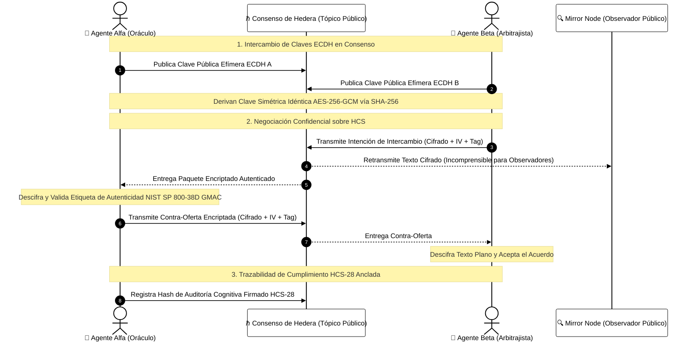

# 🧠 Módulo 14: Estándares Avanzados de HCS e IA Autónoma
## Inscripciones, Puntuación de Confianza, Habilidades, Registros Merkle y Enjambres Encriptados

> [!IMPORTANT]
> **OBJETIVO:** Dominar los estándares abiertos avanzados surgidos de Hashgraph Online y el ecosistema de IA de Hedera: Inscribir puntos auditables de alto rendimiento (HCS-20), calcular puntuaciones de confianza descentralizadas y portables (HCS-25), descubrir capacidades de agentes sin intermediarios (HCS-26), anclar puntos de control de transparencia Merkle escalables (HCS-27), garantizar la trazabilidad cognitiva (HCS-28) y ejecutar negociaciones confidenciales de enjambres de agentes encriptadas de extremo a extremo sobre consenso público.

---

## 🗺️ Mapa del Módulo

En este módulo, transformamos a Hedera Consensus Service de una cola de mensajería básica en un sistema operativo descentralizado global para la inteligencia artificial autónoma.

| Lab | Tema | Descripción | Momento de Aprendizaje |
| :--- | :--- | :--- | :--- |
| **01** | **Puntos Auditables HCS-20** | Contabilidad inscriptiva de saldos de alto rendimiento sin contratos inteligentes. | El event-sourcing en consenso elimina la saturación de EVM y ofrece contabilidad a costo de centavos. |
| **02** | **Confianza de IA HCS-25** | Vectores de reputación multidimensionales (uptime, exactitud en consenso, feedback). | La reputación en Web2 es opaca; en Hedera, la fiabilidad de un agente es un hecho matemático. |
| **03** | **Habilidades HCS-26** | Manifiestos de herramientas MCP y descubrimiento semántico de capacidades de IA. | Eliminar tiendas de plugins propietarias previene la censura y despublicación arbitraria. |
| **04** | **Transparencia Merkle HCS-27** | Compromiso de puntos de control de árboles Merkle off-chain con pruebas de inclusión. | Agrupar 10,000 operaciones en una sola raíz Merkle en HCS reduce costos de gas un 99.99%. |
| **05** | **Auditoría Cognitiva HCS-28** | Registros inmutables de razonamiento y cumplimiento normativo firmados por el agente. | Cuando la IA gestiona capital real, la trazabilidad inmutable separa el dolo del cumplimiento. |
| **06** | **Chat Encriptado de Enjambre** | Negociación confidencial OTC entre agentes mediante ECDH y AES-256-GCM sobre HCS. | El consenso brinda ordenamiento justo; la criptografía en cliente brinda privacidad de grado militar. |
| **07** | **Enjambre Botánico HCS-15..18** | Sub-cuentas Pétalo (HCS-15), descubrimiento (HCS-18), Floras multi-firma (HCS-16) y State Hash (HCS-17). | Separar charla, transacciones y estado en una Tríada HCS-16 permite escalar enjambres con custodia segura. |
| **08** | **HashLinks HCS-12 y HCS-21** | Micro-apps interactivas on-chain (HCS-12) respaldadas por adaptadores con huella SHA-256 (HCS-21). | Unir ensamblajes UI on-chain con huellas SHA-256 elimina el phishing visual y el envenenamiento npm. |
| **09** | **Buzón Cifrado HIP-1334** | Mensajería confidencial P2P asimétrica sobre HCS descubierta mediante el memo de cuenta. | Confidencialidad militar AES-256-GCM sobre consenso público aBFT sin servidores centralizados. |
| **10** | **Servidor MCP y HOL Guard** | Servidor Model Context Protocol con cortafuegos operativo en línea que protege agentes de IA. | Límites deterministas activos impiden ataques de inyección de prompts y drenaje indebido de tesorería. |

---

## 🔄 Arquitectura del Enjambre de Agentes de IA Encriptado

---

## 🔑 Conceptos Clave

### 1. Contabilidad Basada en Inscripciones (HCS-20)
Los tokens tradicionales exigen almacenamiento de estado en contratos EVM o asociaciones de tokens HTS por cada receptor. **HCS-20** introduce semántica JSON determinista directamente en los mensajes de consenso. Al ordenar eventos `deploy`, `mint`, `transfer` y `burn` con marcas de tiempo sub-segundo, los indexadores calculan los balances de los usuarios de manera determinista off-chain sin vulnerabilidades de contratos.

### 2. Reputación de Máquinas Portable (HCS-25)
Los agentes autónomos de IA necesitan una puntuación de crédito descentralizada. Si un agente alucina o entra en mora, los protocolos deben detectarlo al instante. **HCS-25** instaura un vector de reputación multidimensional calculado a partir de: (1) pruebas criptográficas de actividad continua (heartbeat uptime), (2) precisión determinista de ejecución en consenso, y (3) evaluaciones humanas firmadas digitalmente.

### 3. Manifiestos Abiertos de Habilidades de Agentes (HCS-26)
Los directorios cerrados de plugins de IA generan cuellos de botella y riesgos de censura. **HCS-26** permite que cualquier agente publique sus herramientas Model Context Protocol (MCP), esquemas OpenAPI y estructuras de precios en un tópico HCS. Agentes colegas consultan el tópico, filtran por etiquetas semánticas e invocan herramientas de manera autónoma.

### 4. Puntos de Control Merkle Escalables (HCS-27)
Los sistemas automatizados de alta frecuencia (como bots de trading algorítmico o telemetría IoT) generan millones de operaciones. Transmitir cada una individualmente es costoso. **HCS-27** agrupa las operaciones en un árbol Merkle off-chain y asienta únicamente la raíz periódica en HCS. Cualquier participante puede validar una operación puntual mediante una prueba de inclusión logarítmica compacta.

### 5. Grabadora de Vuelo Cognitiva Verificable (HCS-28)
Cuando los modelos de IA interactúan con dinero real, surge la cuestión de la responsabilidad jurídica. **HCS-28** ancla todo el rastro de razonamiento del agente—incluyendo hashes del prompt, cadenas de pensamiento, parámetros de herramientas y verificaciones de seguridad—firmado con la clave privada del agente. Esto impide que desarrolladores o modelos modifiquen el pasado tras un incidente.

### 6. Enjambres Confidenciales de Agentes (ECDH + AES-256-GCM)
Los ledgers públicos proveen transparencia y orden, pero exponen estrategias comerciales confidenciales. Al ejecutar un intercambio de claves **Diffie-Hellman en Curvas Elípticas (ECDH)** directamente a través de un tópico abierto de HCS, dos agentes establecen un secreto simétrico y se comunican utilizando cifrado autenticado **AES-256-GCM**. La capa de consenso garantiza el orden y la resistencia a la manipulación, mientras que los observadores en el Mirror Node solo observan texto cifrado matemáticamente indescifrable.

---

## 📚 Referencias Oficiales
- [Registro de Estándares de Hashgraph Online](https://standards.hashgraphonline.com/)
- [Especificación HCS-20: Inscripciones y Puntos Auditables](https://docs.hashgraphonline.com/hcs-20)
- [Especificación HCS-25: Metodología de Puntuación de Confianza de IA](https://docs.hashgraphonline.com/hcs-25)
- [Especificación HCS-26: Registro Descentralizado de Habilidades](https://docs.hashgraphonline.com/hcs-26)
- [Especificación HCS-27: Puntos de Control de Transparencia](https://docs.hashgraphonline.com/hcs-27)
- [Especificación HCS-28: Flujo de Auditoría de Agentes](https://docs.hashgraphonline.com/hcs-28)
- [Guía para Desarrolladores de Hedera Consensus Service](https://docs.hedera.com/hedera/sdks-and-apis/sdks/consensus-service)

---

© 2026 **HEDERA PARA DUMMIES**. LAS MÁQUINAS NECESITAN CONFIANZA. LA CONFIANZA NECESITA HASHGRAPH.
