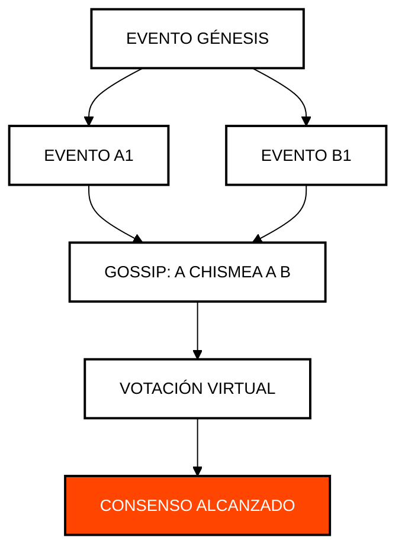

# Módulo 1: Fundamentos y Criptografía
## Arquitectura de Consenso y Soberanía Digital

> [!IMPORTANT]
> **OBJETIVO:** Entender por qué Hedera no es una blockchain y cómo la criptografía de grado industrial asegura la red.

---

## Mapa del Módulo
Este módulo cubre los pilares de la red Hedera: desde el algoritmo Hashgraph hasta la gestión de claves.

| Lab | Tema | Descripción |
| :--- | :--- | :--- |
| **01** | **Consenso aBFT** | Simulación de Gossip-about-Gossip y Votación Virtual. |
| **02** | **Renta de Cuentas** | El modelo económico de almacenamiento on-chain. |
| **03** | **Criptografía KMS** | Firmar transacciones reales con una llave WebCrypto no extraíble, el mismo patrón signWith que usa un KMS o HSM. |
| **04** | **Rotación de Claves** | Cómo cambiar la seguridad de una cuenta sin cambiar su ID. |
| **05** | **Creación Perezosa (Lazy)** | Auto-creación de cuentas enviando HBAR a un alias EVM (HIP-583). |
| **06** | **Staking Nativo** | Delegación de HBAR a nodos de consenso para seguridad y recompensas (HIP-406). |
| **07** | **Motor de Comisiones Simples** | Modelado determinista de comisiones (nodo, red, servicio) y conversión por tipo de cambio (HIP-1261). |
| **08** | **Asignaciones de HBAR (HIP-336)** | Asignaciones de HBAR (HIP-336): el gastador mueve HBAR del patrocinador sin su clave. |

---

## El Algoritmo Hashgraph (Gossip-about-Gossip)

A diferencia de las blockchains tradicionales, Hedera utiliza un DAG (Gráfico Acíclico Dirigido) para alcanzar el consenso de forma asíncrona.

---

## Conceptos Clave

### 1. Gossip-about-Gossip
Los nodos no solo comparten transacciones, sino también el historial de con quién han hablado. Esto crea un registro inmutable de la propagación de la información.

### 2. Votación Virtual
Gracias al historial compartido (DAG), cada nodo puede predecir cómo votarían los demás sin necesidad de enviar votos físicos por la red, ahorrando ancho de banda y tiempo.

### 3. Renta de Cuentas (Storage Rent)
En Hedera, el almacenamiento no es gratuito para siempre. Las cuentas deben pagar una pequeña tarifa de renta para permanecer activas, lo que evita la hinchazón del estado de la red.

---

## Antes de Ejecutar

Cada lab corre desde la web del curso o con `node`. Tu cuenta de testnet firma y paga las comisiones; algunos labs usan además las wallets de práctica `ACCOUNT_1` y `ACCOUNT_2` (créalas en el panel Wallets de la web, o defínelas en `.env`). Un lab con algo en **Ejecuta antes** lee lo que ese lab anterior guardó en `state.json`, así que córrelos en ese orden.

| Lab | Ejecuta antes | Wallets de práctica | Costo |
| :--- | :--- | :--- | :--- |
| **01** | — | — | gratis (no se envía ninguna transacción) |
| **02** | — | Sí | <0.1 ℏ (solo comisiones de red) |
| **03** | — | — | <1 ℏ (creación de la cuenta y comisiones; el depósito de 0.2 ℏ regresa) |
| **04** | — | Sí | <0.1 ℏ (solo comisiones de red) |
| **05** | — | — | ~1 ℏ (solo comisiones de red) |
| **06** | — | — | <0.1 ℏ (solo comisiones de red) |
| **07** | — | — | <0.1 ℏ (solo comisiones de red) |
| **08** | — | — | <1 ℏ |

---

## Referencias Oficiales
- [Whitepaper de Hedera Hashgraph](https://hedera.com/whitepaper)
- [Documentación de Cuentas (Hedera Docs)](https://docs.hedera.com/hedera/networks/mainnet/account-rent)
- [Estándares de Criptografía (HIP-32)](https://hips.hedera.com/hip/hip-32)

---

 2026 **HEDERA PARA DUMMIES**. DISEÑADO PARA LA RESISTENCIA.
