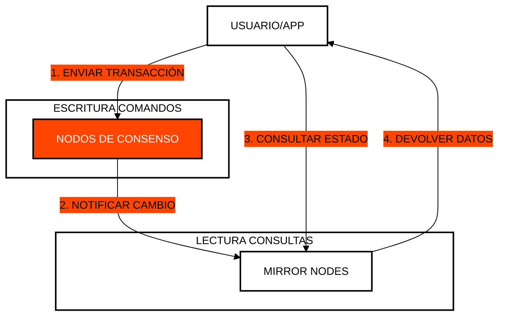

# 🔍 Módulo 2: Interrogación de Estado y CQRS
## Consultas Eficientes y Escalables en la Red

> [!IMPORTANT]
> **OBJETIVO:** Aprender a separar las operaciones de escritura (Consenso) de las de lectura (Mirror Nodes) utilizando el patrón CQRS para maximizar el rendimiento.

---

## 🗺️ Mapa del Módulo

| Lab | Tema | Descripción |
| :--- | :--- | :--- |
| **01** | **Depreciación de Sync** | Por qué consultar el estado directamente a los nodos de consenso es costoso e ineficiente. |
| **02** | **REST API Segura** | Cómo realizar consultas asíncronas a Mirror Nodes de forma segura. |
| **03** | **Paginación Recursiva** | Manejo de grandes volúmenes de datos mediante el uso de "next links". |
| **04** | **Reactor de Event Sourcing** | Ingesta de streams del Mirror Node en un modelo de lectura CQRS SQLite en memoria con consultas sub-ms. |
| **05** | **Circuit Breaker** | Tolerancia a fallos, backoff con jitter y caché de respaldo ante los límites de tasa del Mirror Node. |
| **06** | **Bus de Eventos WebSocket** | Gateway reactivo WebSocket/SSE que empuja transacciones del ledger en vivo. |
| **07** | **Subgrafo GraphQL** | Motor de consultas en grafo que elimina cascadas REST con resolvers de una sola ida y vuelta. |

---

## ⚡ El Patrón CQRS en Hedera

En Hedera, la arquitectura ideal separa las responsabilidades de comandos (cambios de estado) y consultas (lectura de estado).

---

## 🔑 Conceptos Clave

### 1. ¿Por qué evitar Consultas Sincrónicas?
Consultar a un nodo de consenso requiere que este detenga su trabajo principal (validar transacciones) para responderte. Esto es caro (tarifas más altas) y no escala.

### 2. Mirror Nodes (La Capa de Lectura)
Los Mirror Nodes reciben una copia de todas las transacciones confirmadas. Son ideales para consultas de baja latencia, análisis de datos e historial, y generalmente son gratuitos o de bajo costo.

### 3. Paginación y Recursividad
Cuando solicitas una lista larga (ej. todos los tokens de una cuenta), el Mirror Node devuelve un fragmento y un enlace al siguiente (`next`). Aprender a seguir estos enlaces recursivamente es vital para aplicaciones de producción.

---

## 📚 Referencias Oficiales
- [Mirror Node API Documentation](https://mainnet-public.mirrornode.hedera.com/api/v1/docs/)
- [Patrón CQRS en Arquitecturas Distribuidas](https://martinfowler.com/bliki/CQRS.html)
- [Hedera Mirror Node Architecture](https://docs.hedera.com/hedera/core-concepts/mirror-nodes)

---

© 2026 **HEDERA PARA DUMMIES**. ESCALA SIN LÍMITES.
