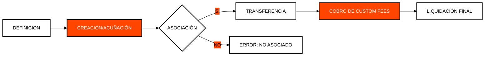

# Módulo 3: Hedera Token Service (HTS)
## Tokenización Nativa con Desempeño de Base de Datos

> [!IMPORTANT]
> **OBJETIVO:** Crear y gestionar activos digitales (tokens fungibles y NFTs) directamente en la capa de consenso, sin la complejidad ni los riesgos de los contratos inteligentes tradicionales.

---

## Mapa del Módulo

| Lab | Tema | Descripción |
| :--- | :--- | :--- |
| **01** | **Emisión Inmutable** | Creación de tokens con suministro fijo y sin llaves de administración. |
| **02** | **Identidad Financiera** | Uso de llaves de KYC y Congelación (Freeze) para cumplimiento regulatorio. |
| **03** | **NFTs y HIP-412** | Creación de NFTs siguiendo el estándar de metadatos de la comunidad. |
| **04** | **Lectura On-Chain** | Consulta de metadatos y estados de tokens desde Mirror Nodes. |
| **05** | **Custom Fees** | Configuración de comisiones fijas por transferencia (Fixed Fees). |
| **06** | **Royalties Nativa** | Implementación de regalías automáticas en la capa base. |
| **07** | **NFTs Dinámicos (HIP-657)** | Mutación dinámica de metadatos on-chain usando la Metadata Key. |
| **08** | **Esquema HIP-412** | Construcción y validación de esquemas JSON enriquecidos para NFTs. |
| **09** | **Bloqueo Post-Tesorería (HIP-850)** | Revelación de metadatos en Tesorería con SupplyKey e inmutabilidad al entregar al usuario. |
| **10** | **NFT Studio: Rareza y Verificador** | Herramientas de creador para puntajes de rareza de rasgos, cumplimiento HIP-412 y airdrops verificados. |

---

## Ciclo de Vida de un Token en HTS

---

## Conceptos Clave

### 1. Tokens Nativos vs Smart Contracts
En Hedera, los tokens son ciudadanos de primera clase. Esto significa que la lógica de transferencia y saldo está integrada en los nodos, lo que los hace 1000 veces más rápidos y baratos que un ERC-20 en Ethereum.

### 2. Estándar HIP-412
Para que los NFTs se vean correctamente en billeteras y mercados, deben seguir una estructura de metadatos específica (JSON en IPFS o HCS). El HIP-412 es el estándar de oro para esto.

### 3. Custom Fees (Comisiones Personalizadas)
Hedera permite definir reglas de cobro a nivel de protocolo. Puedes configurar que cada vez que un token cambie de manos, una parte se envíe automáticamente al creador (Royalties) o una tarifa fija al tesoro.

---

## Referencias Oficiales
- [Hedera Token Service (HTS) Overview](https://docs.hedera.com/hedera/core-concepts/tokens)
- [HIP-412: NFT Metadata JSON Schema](https://hips.hedera.com/hip/hip-412)
- [Token Custom Fees Documentation](https://docs.hedera.com/hedera/networks/mainnet/custom-fees)

---

 2026 **HEDERA PARA DUMMIES**. TOKENIZACIÓN REAL.
