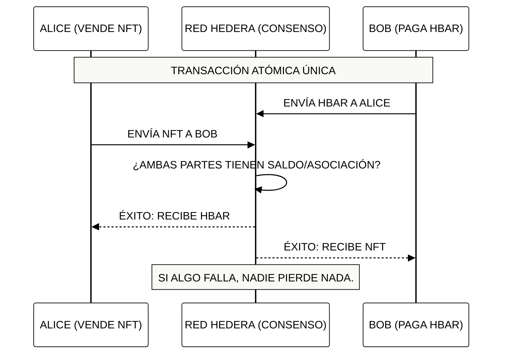

# Módulo 4: Operaciones de Tokens e Intercambios Atómicos
## Comercio sin Confianza y Eficiencia en Transferencias

> [!IMPORTANT]
> **OBJETIVO:** Dominar el movimiento de activos en la red, desde transferencias simples hasta intercambios complejos de múltiples partes donde "todo ocurre o nada ocurre" (Atomicidad).

---

## Mapa del Módulo

| Lab | Tema | Descripción |
| :--- | :--- | :--- |
| **01** | **Transferencias de HBAR** | Envío básico de la moneda nativa entre cuentas. |
| **02** | **Transferencias de Tokens** | Movimiento de tokens fungibles (HTS). |
| **03** | **Transferencias de NFTs** | Intercambio de activos únicos entre coleccionistas. |
| **04** | **Atomic Swaps** | El "Santo Grial" del comercio: intercambio de activos sin intermediarios. |
| **05** | **Transferencias en Paralelo** | Optimización de red enviando múltiples movimientos en un solo batch. |
| **06** | **Airdrops Nativos (HIP-904)** | Distribución masiva de tokens con colas de reclamo pendientes. |
| **07** | **Cancelación y Rechazo (HIP-904)** | Recuperación de airdrops no reclamados y rechazo de tokens spam sin comisiones. |
| **08** | **Liquidación Triangular L1** | Motor CoW en memoria liquidando Ring Trades de 3 operadores de forma atómica en Capa 1. |
| **09** | **Liquidación Atómica Flash** | Cuatro cuentas reales de testnet liquidan préstamo, compra, venta y reembolso (HBAR + token HTS) en una TransferTransaction multifirma; un intento sin fondos se rechaza completo. |
| **10** | **Lote Atómico (HIP-551)** | Dos partes intercambian HBAR y registran la operación en HCS en un solo lote; un lote cuyo último paso falla no deja rastro (REVERTED_SUCCESS). |

---

## El Intercambio Atómico (Atomic Swap)

En Hedera, puedes incluir hasta 10 transferencias en una sola transacción. Si una sola de ellas falla (ej. por saldo insuficiente), TODA la transacción se revierte.

---

## Conceptos Clave

### 1. Atomicidad (All-or-Nothing)
La atomicidad elimina el riesgo de contraparte. No necesitas un "escrow" o un tercero de confianza; la red misma garantiza que el intercambio sea simultáneo.

### 2. Eficiencia de Red
Una sola transacción puede mover HBAR, Tokens Fungibles y NFTs al mismo tiempo. Esto reduce las tarifas y la congestión de la red comparado con hacer múltiples transacciones por separado.

### 3. Límites de Transferencia
Cada transacción de transferencia en Hedera tiene un límite de "puntos de transferencia" (generalmente 10). Esto permite una gran flexibilidad para pagos complejos o distribuciones masivas (Airdrops).

---

## Antes de Ejecutar

Cada lab corre desde la web del curso o con `node`. Tu cuenta de testnet firma y paga las comisiones; algunos labs usan además las wallets de práctica `ACCOUNT_1` y `ACCOUNT_2` (créalas en el panel Wallets de la web, o defínelas en `.env`). Un lab con algo en **Ejecuta antes** lee lo que ese lab anterior guardó en `state.json`, así que córrelos en ese orden.

| Lab | Ejecuta antes | Wallets de práctica | Costo |
| :--- | :--- | :--- | :--- |
| **01** | — | Sí | ~1 ℏ (solo comisiones de red) |
| **02** | Lab 01 de M3 | Sí | <0.1 ℏ (solo comisiones de red) |
| **03** | Lab 03 de M3 | Sí | <0.1 ℏ (solo comisiones de red) |
| **04** | Lab 03 de M3 | Sí | <0.1 ℏ (solo comisiones de red) |
| **05** | — | Sí | <1 ℏ (solo comisiones de red) |
| **06** | — | — | ~15 ℏ la primera vez (crea un token, cerca de 1 USD); ~2 ℏ al volver a ejecutarlo (reutiliza lo que creó) |
| **07** | — | — | ~15 ℏ la primera vez (crea un token, cerca de 1 USD); ~3 ℏ al volver a ejecutarlo (reutiliza lo que creó) |
| **08** | — | — | ~35 ℏ la primera vez (crea 2 tokens, cerca de 2 USD); ~6 ℏ al volver a ejecutarlo (reutiliza lo que creó) |
| **09** | — | — | ~17 ℏ (crear el token FLASH ~15 ℏ en testnet) + ~0.6 ℏ para cuentas desechables + comisiones |
| **10** | — | Sí | <1 ℏ la primera vez (topic); unos 0.05 ℏ por ejecución después, repartidos entre las tres cuentas |

---

## Referencias Oficiales
- [Transfer Transactions (Hedera Docs)](https://docs.hedera.com/hedera/sdks-and-apis/sdks/transactions/transfer-tokens)
- [Understanding Atomicity in DLT](https://hedera.com/learning/hedera-hashgraph/what-is-atomicity)
- [Token Transfer Limits and Fees](https://docs.hedera.com/hedera/networks/mainnet/fees)

---

 2026 **HEDERA PARA DUMMIES**. COMERCIO SEGURO.
