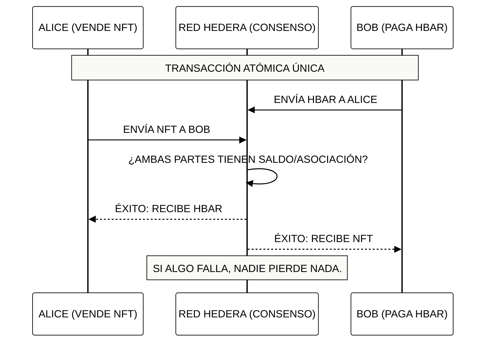

# Módulo 4: Operaciones de Tokens e Intercambios Atómicos
## Comercio sin Confianza y Eficiencia en Transferencias

> [!IMPORTANT]
> **OBJETIVO:** Dominar el movimiento de activos en la red, desde transferencias simples hasta intercambios complejos de múltiples partes donde "todo ocurre o nada ocurre" (Atomicidad).

---

## Mapa del Módulo

| Lab | Tema | Descripción |
| :--- | :--- | :--- |
| **01** | **Transferencias de HBAR** | Envío básico de la moneda nativa entre cuentas. |
| **02** | **Transferencias de Tokens** | Movimiento de tokens fungibles (HTS). |
| **03** | **Transferencias de NFTs** | Intercambio de activos únicos entre coleccionistas. |
| **04** | **Atomic Swaps** | El "Santo Grial" del comercio: intercambio de activos sin intermediarios. |
| **05** | **Transferencias en Paralelo** | Optimización de red enviando múltiples movimientos en un solo batch. |
| **06** | **Airdrops Nativos (HIP-904)** | Distribución masiva de tokens con colas de reclamo pendientes. |
| **07** | **Cancelación y Rechazo (HIP-904)** | Recuperación de airdrops no reclamados y rechazo de tokens spam sin comisiones. |
| **08** | **Liquidación Triangular L1** | Motor CoW en memoria liquidando Ring Trades de 3 operadores de forma atómica en Capa 1. |
| **09** | **Liquidación Atómica Flash** | Préstamos flash sin capital, arbitraje de diferenciales y reembolso de comisiones en una transacción L1. |

---

## El Intercambio Atómico (Atomic Swap)

En Hedera, puedes incluir hasta 10 transferencias en una sola transacción. Si una sola de ellas falla (ej. por saldo insuficiente), TODA la transacción se revierte.

---

## Conceptos Clave

### 1. Atomicidad (All-or-Nothing)
La atomicidad elimina el riesgo de contraparte. No necesitas un "escrow" o un tercero de confianza; la red misma garantiza que el intercambio sea simultáneo.

### 2. Eficiencia de Red
Una sola transacción puede mover HBAR, Tokens Fungibles y NFTs al mismo tiempo. Esto reduce las tarifas y la congestión de la red comparado con hacer múltiples transacciones por separado.

### 3. Límites de Transferencia
Cada transacción de transferencia en Hedera tiene un límite de "puntos de transferencia" (generalmente 10). Esto permite una gran flexibilidad para pagos complejos o distribuciones masivas (Airdrops).

---

## Referencias Oficiales
- [Transfer Transactions (Hedera Docs)](https://docs.hedera.com/hedera/sdks-and-apis/sdks/transactions/transfer-tokens)
- [Understanding Atomicity in DLT](https://hedera.com/learning/hedera-hashgraph/what-is-atomicity)
- [Token Transfer Limits and Fees](https://docs.hedera.com/hedera/networks/mainnet/fees)

---

 2026 **HEDERA PARA DUMMIES**. COMERCIO SEGURO.
