# Módulo 5: Hedera Consensus Service (HCS)
## Confianza Descentralizada para Datos Arbitrarios

> [!IMPORTANT]
> **OBJETIVO:** Utilizar Hedera como una "Capa de Confianza" para ordenar y estampar el tiempo de cualquier mensaje o dato sin necesidad de almacenarlo en el estado principal de la red.

---

## Mapa del Módulo

| Lab | Tema | Descripción |
| :--- | :--- | :--- |
| **01** | **Temas Inmutables** | Creación de canales de comunicación (Topics) persistentes. |
| **02** | **Estándares de Datos** | Estructuración de mensajes en JSON para interoperabilidad. |
| **03** | **Fragmentación (Chunking)**| Envío de mensajes grandes divididos en partes automáticas. |
| **04** | **Ping-Pong HCS** | Simulación de comunicación bidireccional entre agentes. |
| **05** | **Registro HCS-6** | Descubrimiento dinámico de servicios y dApps on-chain mediante tópicos HCS-6. |
| **06** | **Tópicos Monetizados (HIP-991)** | Monetización de tópicos HCS con tarifas fijas en HBAR o tokens HTS. |
| **07** | **Ingesta Masiva Merkle** | Motor de ingesta masiva en memoria anclando raíces Merkle Keccak-256 con pruebas O(log N). |
| **08** | **Puente de Streaming Kafka** | Puente de transmisión masiva empresarial anclando marcas de agua de particiones en HCS. |

---

## Flujo de Mensajería en HCS

HCS no almacena el contenido del mensaje permanentemente en los nodos de consenso; solo garantiza el orden y la validez. Los Mirror Nodes se encargan de la persistencia para los suscriptores.

```mermaid
%%{init: {
  'theme': 'base',
  'themeVariables': {
    'primaryColor': '#ffffff',
    'primaryTextColor': '#000000',
    'primaryBorderColor': '#000000',
    'lineColor': '#000000',
    'secondaryColor': '#FF4500',
    'tertiaryColor': '#ffffff',
    'mainBkg': '#ffffff',
    'nodeBorder': '#000000',
    'clusterBkg': '#F9F9F6',
    'clusterBorder': '#000000',
    'fontSize': '14px',
    'fontFamily': 'Inter, system-ui, -apple-system, sans-serif',
    'nodeRadius': '0px'
  }
}}%%
graph LR
    A[EMISOR] -->|1. ENVIAR MENSAJE| B[TOPIC DE HEDERA]
    B -->|2. ORDENAR Y ESTAMPAR| C[NODOS DE CONSENSO]
    C -->|3. NOTIFICAR| D[MIRROR NODES]
    D -->|4. TRANSMITIR| E[SUSCRIPTOR/APP]
    
    %% Styling
    classDef default fill:#ffffff,stroke:#000000,stroke-width:2px;
    classDef accent fill:#FF4500,stroke:#000000,stroke-width:2px,color:#ffffff;
    
    class B default;
    class C accent;
    class D default;
```

---

## Conceptos Clave

### 1. Topics (Temas)
Un Topic es como un canal de chat criptográfico. Puede ser público (cualquiera puede leer/escribir) o privado (requiere llaves de firma para enviar mensajes).

### 2. Estampado de Tiempo (Consensus Timestamp)
Cada mensaje en HCS recibe un "Consensus Timestamp" único. Esto permite crear registros de auditoría infalsificables donde se sabe exactamente cuándo ocurrió un evento en relación con todos los demás.

### 3. Chunking (Fragmentación)
El límite de tamaño de un mensaje en Hedera es de 1024 bytes. Para enviar archivos o datos más grandes, el SDK permite fragmentar el mensaje en múltiples partes que el suscriptor puede reconstruir automáticamente.

---

## Referencias Oficiales
- [Hedera Consensus Service (HCS) Whitepaper](https://hedera.com/consensus-service)
- [Working with Topics and Messages](https://docs.hedera.com/hedera/core-concepts/consensus-service)
- [HCS Message Chunking Logic](https://docs.hedera.com/hedera/sdks-and-apis/sdks/consensus-service/submit-a-message)

---

 2026 **HEDERA PARA DUMMIES**. LA VERDAD ES DESCENTRALIZADA.
