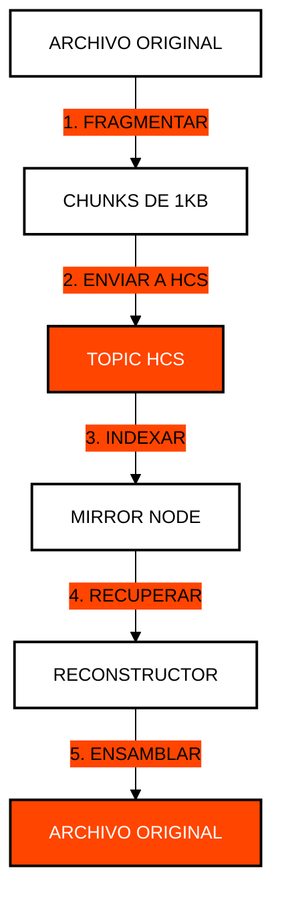

# Módulo 6: Almacenamiento Masivo y Hashinals
## Datos Inmutables a Escala Global

> [!IMPORTANT]
> **OBJETIVO:** Aprender a almacenar archivos grandes y metadatos complejos utilizando una combinación de HFS (File Service) y el estándar HCS-1 para crear "Hashinals".

---

## Mapa del Módulo

| Lab | Tema | Descripción |
| :--- | :--- | :--- |
| **01** | **HFS Nativo** | Creación y lectura de archivos pequeños en el servicio de archivos de Hedera. |
| **02** | **Archivos Grandes en HFS** | Manejo de límites de tamaño mediante la actualización de archivos. |
| **03** | **Carga en Lote (Batch)** | Optimización de la subida de múltiples archivos. |
| **04** | **Estándar HCS-1** | Almacenamiento atómico de datos mediante el uso de Topics de HCS. |
| **05** | **Reconstrucción HCS-1** | Recuperación y ensamblado de datos fragmentados desde Mirror Nodes. |
| **06** | **Hashinals Dinámicos (HCS-6)** | Un NFT que evoluciona: su metadata apunta a un registro HCS-6 cuya última entrada es la versión vigente. |
| **07** | **NFT Nativo HCS-1** | Creación de un NFT totalmente descentralizado con metadatos e imagen en HCS. |
| **08** | **Reconstrucción de NFT** | Recuperación y ensamblado de un NFT completo desde Mirror Node shards. |
| **09** | **Smart Hashinals HCS-7** | Un NFT dinámico resuelto como una wallet: precio real del HBAR desde un contrato, un router WASM inscrito con HCS-1, dos variantes (`hol.org`). |
| **10** | **Bóveda Cifrada Zero-Trust** | Cifrado de sobre Gzip + AES-KW + AES-256-GCM, guardado y leído de vuelta como archivo HCS-1. |

---

## Arquitectura HCS-1 (Hashinals)

A diferencia de HFS, HCS-1 fragmenta un archivo y lo inyecta en un Topic de HCS. Esto es más económico y permite una inmutabilidad total sin necesidad de llaves de administración.

---

## Conceptos Clave

### 1. Hedera File Service (HFS)
HFS actúa como un sistema de archivos tradicional en la red. Es ideal para archivos que necesitan ser actualizados o que requieren permisos específicos de administración.

### 2. Hashinals (HCS-1)
Los Hashinals son la respuesta de Hedera a los "Ordinals" de Bitcoin. Utilizan el servicio de consenso para inscribir datos de forma permanente. Es el método más económico para almacenar grandes volúmenes de datos inmutables.

### 3. Inmutabilidad Económica
Mientras que almacenar 1GB en una blockchain tradicional puede costar miles de dólares, el uso estratégico de HCS-1 y compresión permite reducir estos costos drásticamente, manteniendo la seguridad del consenso de Hedera.

---

## El Estándar hcs:// (NFT Recursivo)

El protocolo `hcs://` es un formato de URI impulsado por la comunidad que permite la resolución recursiva de activos. En lugar de apuntar a un CID (IPFS) o una URL, el NFT apunta a un Topic de HCS.

**Formato del Puntero:** `hcs://<TOPIC_ID>?fid=<METADATA_FID>`

1. **Resolución**: El cliente obtiene todos los mensajes del Topic.
2. **Reconstrucción**: Filtra los mensajes por `fid` (Identidad del Archivo) para reconstruir los metadatos JSON.
3. **Paso Recursivo**: Los metadatos contienen otro puntero `hcs://` hacia el activo binario (imagen/video).
4. **Ensamblado Final**: El cliente reconstruye el activo binario sobre la marcha.

---

## Antes de Ejecutar

Cada lab corre desde la web del curso o con `node`. Tu cuenta de testnet firma y paga las comisiones; algunos labs usan además las wallets de práctica `ACCOUNT_1` y `ACCOUNT_2` (créalas en el panel Wallets de la web, o defínelas en `.env`). Un lab con algo en **Ejecuta antes** lee lo que ese lab anterior guardó en `state.json`, así que córrelos en ese orden.

| Lab | Ejecuta antes | Wallets de práctica | Costo |
| :--- | :--- | :--- | :--- |
| **01** | — | — | ~5 ℏ en cada ejecución (sube un archivo, cerca de 0.3 USD) |
| **02** | — | — | ~15 ℏ en cada ejecución (sube un archivo, cerca de 1.2 USD) |
| **03** | Lab 01 de M6 | — | ~9 ℏ en cada ejecución (sube un archivo, cerca de 0.5 USD) |
| **04** | — | — | <1 ℏ (solo comisiones de red) |
| **05** | Lab 04 de M6 | — | gratis (solo lecturas del Mirror Node) |
| **06** | — | — | ~15 ℏ la primera vez (crea un token, cerca de 1 USD); <1 ℏ al volver a ejecutarlo (reutiliza lo que creó) |
| **07** | — | — | ~15 ℏ la primera vez (crea un token, cerca de 1 USD); ~3 ℏ al volver a ejecutarlo (reutiliza lo que creó) |
| **08** | Lab 07 de M6 | — | gratis (solo lecturas del Mirror Node) |
| **09** | — | — | ~15 ℏ la primera vez (despliega el contrato de precio, cerca de 1 USD); ~1 ℏ al volver a ejecutarlo (reutiliza el contrato y las inscripciones) |
| **10** | — | — | <1 ℏ (solo comisiones de red) |

---

## Referencias Oficiales
- [Hedera File Service (HFS) Guide](https://docs.hedera.com/hedera/core-concepts/file-service)
- [HCS-1: Atomic Storage Standard](https://hashinals.com/)
- [Cost Comparison: HFS vs HCS Storage](https://hedera.com/fees)

---

 2026 **HEDERA PARA DUMMIES**. LOS DATOS SON PARA SIEMPRE.
