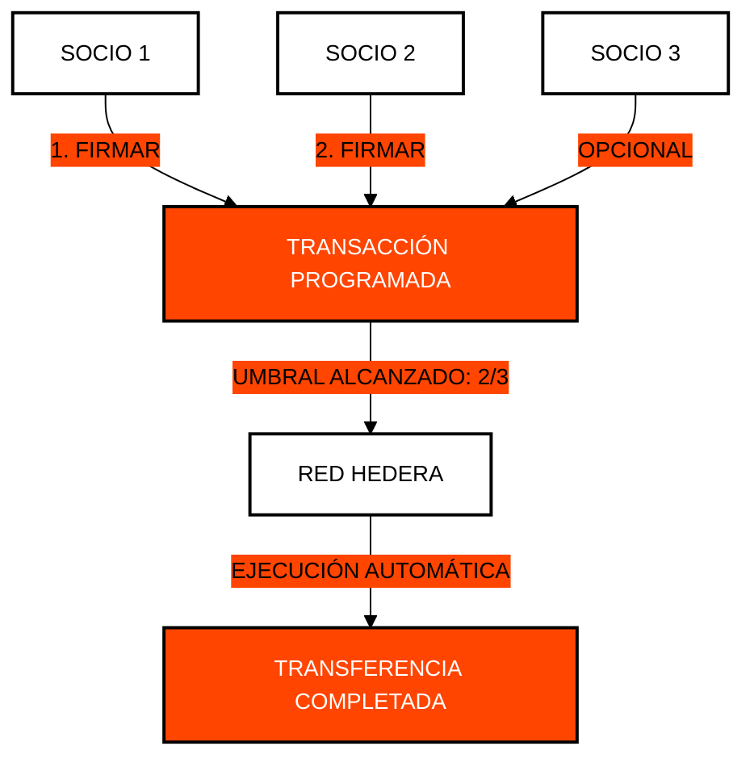

# ⚖️ Módulo 7: Gobernanza y Automatización (Cron)
## Control Multi-Firma y Orquestación Descentralizada

> [!IMPORTANT]
> **OBJETIVO:** Implementar modelos de seguridad avanzados mediante cuentas multi-firma y automatizar transacciones en el futuro utilizando el servicio nativo de transacciones programadas.

---

## 🗺️ Mapa del Módulo

| Lab | Tema | Descripción |
| :--- | :--- | :--- |
| **01** | **Multi-sig KeyList** | Creación de cuentas que requieren múltiples firmas (Threshold Keys). |
| **02** | **Transferencia Multi-sig** | Ejecución de movimientos que dependen de la aprobación de varios socios. |
| **03** | **Cron Nativo** | Programación de transacciones para su ejecución automática en el futuro. |
| **04** | **Orquestación Desacoplada**| Separación de la lógica de negocio de la ejecución en red. |
| **05** | **Identidad Descentralizada**| Creación de documentos DID para soberanía de identidad. |
| **06** | **Login DID** | Verificación de identidad criptográfica sin contraseñas. |
| **07** | **DAO de Tesorería Autónoma**| Orquestación multifirma reactiva impulsada por webhooks y ejecución de quórum en Capa 1. |
| **08** | **Controlador Timelock y Veto**| Ventanas de ejecución timelock de 48h y veto criptográfico de emergencia en Hedera Schedule Service. |

---

## 🔐 Gobernanza Multi-Firma (Threshold)

En Hedera, puedes definir que una cuenta requiera, por ejemplo, 2 de 3 firmas para mover fondos. Esto elimina los puntos únicos de falla.

---

## 🔑 Conceptos Clave

### 1. Umbrales de Firma (Threshold Keys)
A diferencia de un contrato inteligente complejo, Hedera permite definir listas de llaves con umbrales directamente en la cuenta. Es más seguro, más barato y más fácil de auditar.

### 2. Transacciones Programadas (Scheduled Transactions)
Esta función permite "congelar" una transacción en la red hasta que se cumplan las condiciones (como las firmas necesarias) o hasta que llegue un momento específico. Es el "Cron Job" nativo de la Web3.

### 3. DID (Decentralized Identity)
Utilizando HCS, podemos anclar metadatos de identidad que permiten a los usuarios demostrar quiénes son sin depender de una base de datos centralizada como la de Google o Facebook.

---

## 📚 Referencias Oficiales
- [Multi-signature Accounts (Hedera Docs)](https://docs.hedera.com/hedera/core-concepts/keys-and-signatures#multi-signature-signing)
- [Scheduled Transactions Documentation](https://docs.hedera.com/hedera/sdks-and-apis/sdks/scheduled-transactions)
- [W3C Decentralized Identifiers (DID) Standard](https://www.w3.org/TR/did-core/)

---

© 2026 **HEDERA PARA DUMMIES**. EL PODER ES COMPARTIDO.
