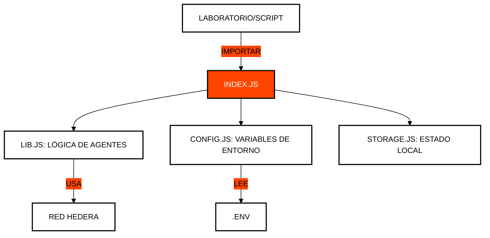

# 🛠️ Módulo 99: Utilidades y Helpers
## La Caja de Herramientas del Desarrollador

> [!IMPORTANT]
> **OBJETIVO:** Centralizar las funciones repetitivas, la gestión de configuración y las utilidades de red para mantener un código limpio y modular en todo el curso.

---

## 🗺️ Mapa del Módulo

| Archivo | Propósito | Descripción |
| :--- | :--- | :--- |
| **lib.js** | **Librería Core** | Funciones compartidas para comunicación HCS, firmas y manejo de claves. |
| **config.js** | **Gestión de Entorno**| Carga y validación de variables desde el archivo `.env`. |
| **storage.js** | **Persistencia Local**| Gestión del estado en archivos JSON (`state.json`). |
| **transfer.js** | **Motores de Envío** | Simplificación de transferencias complejas de HBAR y tokens. |
| **explorer.js** | **Links de Auditoría**| Generación de enlaces directos a HashScan para verificación. |

---

## 🏗️ Integración de Utilidades

Todas las lecciones del curso dependen de este módulo para interactuar con la red Hedera de forma estandarizada.

---

## 🔑 Conceptos Clave

### 1. DRY (Don't Repeat Yourself)
En lugar de escribir la lógica de conexión a Hedera en cada archivo, la centralizamos aquí. Esto facilita el mantenimiento: si el SDK cambia, solo actualizamos un archivo.

### 2. Gestión de Estado (`state.json`)
Para que los laboratorios sean progresivos, necesitamos guardar IDs de cuentas o tokens creados en pasos anteriores. `storage.js` maneja esta persistencia de forma transparente.

### 3. Abstracción de Comunicación
La clase `AgentCommunicationHandler` en `lib.js` abstrae la complejidad de las suscripciones a Mirror Nodes y el filtrado de mensajes, permitiendo que los laboratorios se enfoquen en la lógica de IA.

---

## 📚 Referencias Oficiales
- [Clean Code Principles](https://blog.cleancoder.com/uncle-bob/2012/08/13/the-clean-architecture.html)
- [Node.js File System (fs) API](https://nodejs.org/api/fs.html)
- [Hiero SDK for JavaScript](https://github.com/hashgraph/hedera-sdk-js)

---

© 2026 **HEDERA PARA DUMMIES**. CÓDIGO LIMPIO, MENTE LIMPIA.
