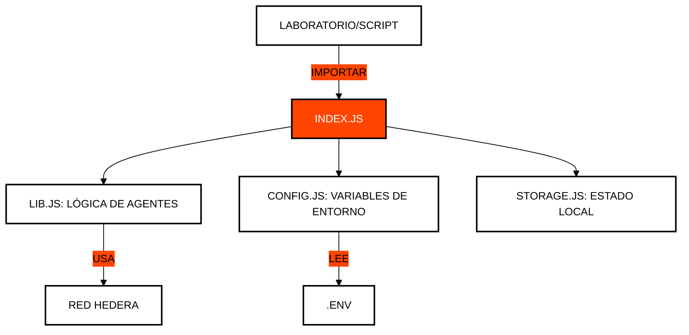

# 🛠️ Módulo 99: Utilidades y Helpers
## La Caja de Herramientas del Desarrollador

> [!IMPORTANT]
> **OBJETIVO:** Centralizar las funciones repetitivas, la gestión de configuración y las utilidades de red para mantener un código limpio y modular en todo el curso.

---

## 🗺️ Mapa del Módulo

| Archivo | Propósito | Descripción |
| :--- | :--- | :--- |
| **lib.js** | **Librería Core** | Funciones compartidas para comunicación HCS, firmas y manejo de claves. |
| **config.js** | **Gestión de Entorno**| Carga `.env`, valida credenciales y crea clientes (`getClient`, `createClient`) con un tope de comisión holgado. |
| **storage.js** | **Persistencia Local**| `updateState`/`getState`: `state.json` por módulo más uno compartido por todo el curso, con escritura atómica. |
| **resilience.js** | **Resiliencia de Red**| `withGasRetry`/`executeWithGas`, `waitForMirror`, `getAccountEvmAddress`, `ensureFunded`, `getJsonRpcSigner`. |
| **transfer.js** | **Motores de Envío** | Simplificación de transferencias complejas de HBAR y tokens. |
| **explorer.js** | **Links de Auditoría**| Generación de enlaces directos a HashScan para verificación. |

---

## 🛡️ Labs que siguen funcionando

Las comisiones, el costo del gas y los tiempos del Mirror Node cambian con el tiempo. Los labs se mantienen confiables cuando usan estas utilidades en lugar de números fijos:

| Problema | Usa | Por qué |
| :--- | :--- | :--- |
| `INSUFFICIENT_TX_FEE` | `getClient()` / `createClient()` | Los clientes traen un tope de 100 ℏ (`MAX_TRANSACTION_FEE_HBAR`). Solo se cobra la comisión real. Evita `setMaxTransactionFee` con valores bajos. |
| `INSUFFICIENT_GAS` | `executeWithGas((gas) => tx.setGas(gas), client, { gas })`, `withGasRetry` para consultas | Reintenta duplicando el gas, hasta el límite de 15M. |
| Datos que aún no están en el Mirror Node | `waitForMirror(async () => …)` | El Mirror Node muestra los datos nuevos unos segundos después del consenso. |
| Paga una cuenta secundaria | `ensureFunded(client, accountId, minHbar)` | La recarga desde el operador antes de que se quede sin saldo. |
| Dirección EVM de una cuenta | `getAccountEvmAddress(accountId)` | Devuelve el alias o la dirección long-zero que la red realmente usa. |
| ethers / relay JSON-RPC | `getJsonRpcSigner(client, operatorKey)` | El relay solo asocia cuentas ECDSA con alias; crea una la primera vez si hace falta. |
| Estado de otro módulo | `getState(key)` | Lee el `state.json` del módulo, luego el del curso y por último `.env`. |

Todos los labs terminan igual: una falla impresa con `❌` marca `process.exitCode = 1` y el bloque de entrada termina el proceso, así ningún lab se queda colgado.

---

## 🏗️ Integración de Utilidades

Todas las lecciones del curso dependen de este módulo para interactuar con la red Hedera de forma estandarizada.

---

## 🔑 Conceptos Clave

### 1. DRY (Don't Repeat Yourself)
En lugar de escribir la lógica de conexión a Hedera en cada archivo, la centralizamos aquí. Esto facilita el mantenimiento: si el SDK cambia, solo actualizamos un archivo.

### 2. Gestión de Estado (`state.json`)
Para que los laboratorios sean progresivos, necesitamos guardar IDs de cuentas o tokens creados en pasos anteriores. `storage.js` maneja esta persistencia de forma transparente.

### 3. Abstracción de Comunicación
La clase `AgentCommunicationHandler` en `lib.js` abstrae la complejidad de las suscripciones a Mirror Nodes y el filtrado de mensajes, permitiendo que los laboratorios se enfoquen en la lógica de IA.

---

## 📚 Referencias Oficiales
- [Clean Code Principles](https://blog.cleancoder.com/uncle-bob/2012/08/13/the-clean-architecture.html)
- [Node.js File System (fs) API](https://nodejs.org/api/fs.html)
- [Hiero SDK for JavaScript](https://github.com/hashgraph/hedera-sdk-js)

---

© 2026 **HEDERA PARA DUMMIES**. CÓDIGO LIMPIO, MENTE LIMPIA.
