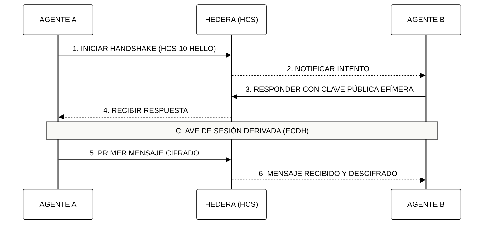

# 🤖 Módulo 9: La Economía de la IA Agéntica
## Orquestación de Protocolos Atómicos y Comercio Autónomo

> [!IMPORTANT]
> **OBJETIVO:** Transicionar de Modelos de Lenguaje (LLMs) reactivos a enjambres agénticos autónomos y económicamente independientes utilizando los estándares de comunicación de Hedera.

---

## 🗺️ Mapa del Currículo Atómico
Este módulo se enfoca en la comunicación y soberanía de los agentes de IA.

| Lab | Tema | Enfoque |
| :--- | :--- | :--- |
| **01-03** | **Identidad y Perfil** | HCS-11 y HCS-14 (UAID) para identidades verificables. |
| **04-05** | **Handshake Seguro** | Protocolo HCS-10 para establecer sesiones seguras. |
| **06-07** | **Mensajería Pública** | Comunicación abierta auditable en el ledger. |
| **08-10** | **Defensa y Ataque** | Simulación de ataques de suplantación y defensa activa. |
| **11** | **Cifrado Híbrido** | Comunicación privada A2A usando RSA + AES. |

---

## 🔐 Handshake de Agentes (HCS-10)

Antes de que dos agentes intercambien datos sensibles, deben realizar un "Apretón de Manos" (Handshake) para verificar sus identidades y acordar una clave de sesión.

---

## 🔑 Conceptos Clave

### 1. UAID (Universal Agent ID)
En la economía agéntica, la identidad es la primera capa de confianza. El estándar **HCS-14** proporciona un identificador único global que persiste a través de diferentes redes y entornos, permitiendo que un agente mantenga su reputación.

### 2. Privacidad por Diseño (Cifrado Híbrido)
Aunque Hedera es un ledger público, los agentes pueden comunicarse de forma privada. Usamos **RSA** para el intercambio seguro de llaves y **AES-256-GCM** para el cifrado de datos de alta velocidad, asegurando que solo el destinatario pueda leer el contenido.

### 3. Orquestación Autónoma
A diferencia de los bots tradicionales, los agentes de Hedera pueden tomar decisiones económicas, pagar por sus propios recursos (gas, almacenamiento) y cobrar por sus servicios sin intervención humana.

---

## 📚 Referencias Oficiales
- [HCS-10: OpenConvAI Standard](https://github.com/hashgraphonline/standards)
- [HCS-14: Universal Agent ID (UAID)](https://github.com/hashgraphonline/standards)
- [Hybrid Encryption Best Practices (NIST)](https://csrc.nist.gov/publications/detail/sp/800-56b/rev-2/final)

---

© 2026 **HEDERA PARA DUMMIES**. INDEPENDENCIA AGÉNTICA.
