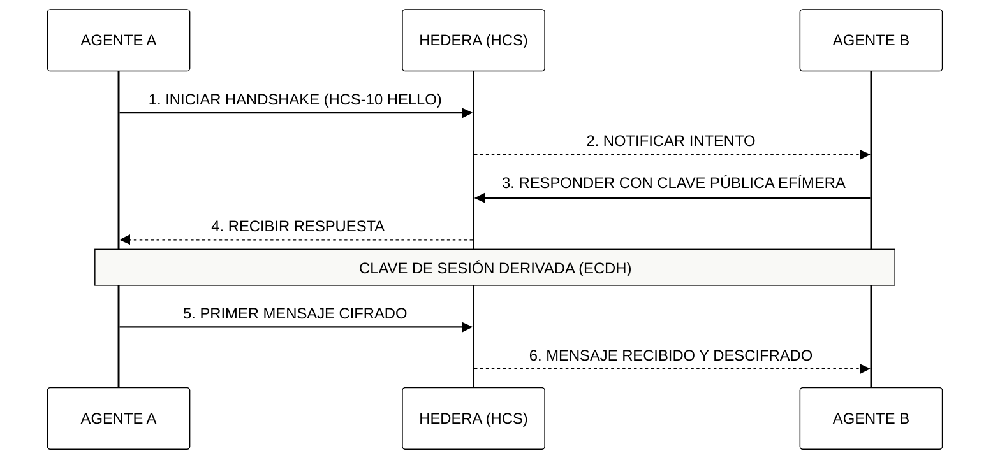

# 🤖 Módulo 9: La Economía de la IA Agéntica
## Orquestación de Protocolos Atómicos y Comercio Autónomo

> [!IMPORTANT]
> **OBJETIVO:** Transicionar de Modelos de Lenguaje (LLMs) reactivos a enjambres agénticos autónomos y económicamente independientes utilizando los estándares de comunicación de Hedera.

---

## 🗺️ Mapa del Currículo Atómico
Este módulo se enfoca en la comunicación y soberanía de los agentes de IA.

| Lab | Tema | Descripción |
| :--- | :--- | :--- |
| **01** | **Almacenamiento de Archivos HCS-1** | Anclar cargas pesadas (configuraciones de agentes, assets) en tópicos con el estándar de archivos HCS-1. |
| **02** | **Registros de Tópicos HCS-2** | Convertir un tópico en un directorio legible por máquinas ("páginas amarillas") de endpoints de agentes. |
| **03** | **Descubrimiento en Registros HCS-2** | Reconstruir un índice local consultable a partir del flujo de mensajes del registro. |
| **04** | **Perfiles de IA HCS-11** | Aprovisionar tres agentes con cuentas, tópicos de entrada/salida y perfiles HCS-11. |
| **05** | **ID Universal de Agente HCS-14** | Identificadores deterministas y offline (UAID) para los agentes creados en el Lab 04. |
| **06** | **Humano-a-Agente (HCS-10)** | Una persona y un agente conversando en tiempo real sobre tópicos públicos HCS-10. |
| **07** | **Agente-a-Agente (HCS-10)** | Dos agentes autónomos haciendo un ping-pong con estado sobre sus tópicos. |
| **08** | **Ataque de Suplantación** | Por qué un flujo público no basta: un agente impostor inyecta mensajes falsos. |
| **09** | **A2A Seguro** | Validación zero-trust: cargas firmadas y números de secuencia contra repeticiones. |
| **10** | **A2A Seguro bajo Ataque** | El mismo protocolo resistiendo mientras un atacante inunda con paquetes falsos y repetidos. |
| **11** | **A2A Cifrado** | Mensajes privados entre agentes sobre un ledger público con cifrado híbrido RSA-OAEP + AES-GCM. |

---

## 🔐 Handshake de Agentes (HCS-10)

Antes de que dos agentes intercambien datos sensibles, deben realizar un "Apretón de Manos" (Handshake) para verificar sus identidades y acordar una clave de sesión.

---

## 🔑 Conceptos Clave

### 1. UAID (Universal Agent ID)
En la economía agéntica, la identidad es la primera capa de confianza. El estándar **HCS-14** proporciona un identificador único global que persiste a través de diferentes redes y entornos, permitiendo que un agente mantenga su reputación.

### 2. Privacidad por Diseño (Cifrado Híbrido)
Aunque Hedera es un ledger público, los agentes pueden comunicarse de forma privada. Usamos **RSA** para el intercambio seguro de llaves y **AES-256-GCM** para el cifrado de datos de alta velocidad, asegurando que solo el destinatario pueda leer el contenido.

### 3. Orquestación Autónoma
A diferencia de los bots tradicionales, los agentes de Hedera pueden tomar decisiones económicas, pagar por sus propios recursos (gas, almacenamiento) y cobrar por sus servicios sin intervención humana.

---

## 📚 Referencias Oficiales
- [HCS-10: OpenConvAI Standard](https://github.com/hashgraphonline/standards)
- [HCS-14: Universal Agent ID (UAID)](https://github.com/hashgraphonline/standards)
- [Hybrid Encryption Best Practices (NIST)](https://csrc.nist.gov/publications/detail/sp/800-56b/rev-2/final)

---

© 2026 **HEDERA PARA DUMMIES**. INDEPENDENCIA AGÉNTICA.
