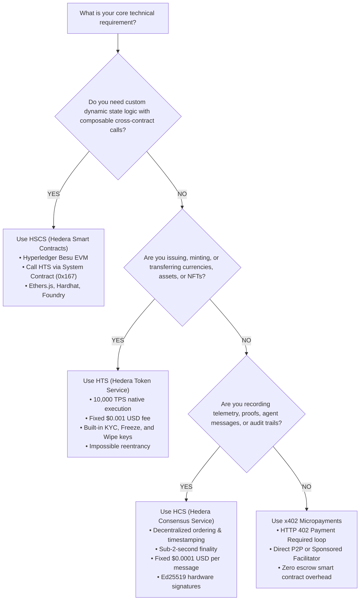

# 🏛️ Hedera Architecture Decision Tree & Anti-Hallucination Guardrails
### Technical Guide for Builders, Judges & Autonomous AI Coding Agents (ETHGlobal Mumbai)

> **PURPOSE:**  
> This document guides developers, system architects, and autonomous coding agents in selecting the correct Hedera architectural primitives (*HCS vs HTS vs HSCS*) and provides an exhaustive cheat-sheet of Hedera technical guardrails to prevent common development pitfalls.

---

## 🧭 Part 1: The Hedera Architectural Decision Tree

### 1. The Ethereum Mindset Trap
Developers arriving from Ethereum or EVM L2s typically suffer from **Smart Contract Over-Engineering**:
- In EVM networks, tokens, escrows, registries, and logging require deploying custom Solidity smart contracts.
- This introduces **smart contract bytecode risk, reentrancy vulnerabilities, variable gas spikes, and latency bottlenecks**.

On Hedera, **tokens and consensus messaging are native network primitives**, executed directly by the consensus nodes in compiled C++ / Java, completely bypassing the EVM:
- **Hedera Token Service (HTS):** Native token engine operating at 10,000 TPS with fixed $0.001 USD transfer fees.
- **Hedera Consensus Service (HCS):** Decentralized timestamping and ordering engine operating at sub-2-second finality with fixed $0.0001 USD message fees.
- **Hedera Smart Contract Service (HSCS):** EVM-compatible execution layer used *only* when custom stateful computation or composable multi-step contract logic is genuinely required.

---

### 2. Architectural Comparison Matrix

| Dimension | **HCS (Consensus Service)** | **HTS (Token Service)** | **HSCS (Smart Contracts)** | **x402 Micropayments** |
| :--- | :--- | :--- | :--- | :--- |
| **Primary Purpose** | Verifiable logs, IoT telemetry, DePIN, multi-agent comms | Native fungible tokens, NFTs, RWA assets, stablecoins | Composable DeFi pools, dynamic lending, custom state machines | Autonomous AI agent HTTP payments & per-call API access |
| **Throughput** | 10,000+ TPS | 10,000+ TPS | ~350–500 TPS (EVM bound) | Instant off-chain auth + sub-2s on-chain settlement |
| **Finality** | Sub-2 seconds | Sub-2 seconds | Sub-2 seconds | Sub-2 seconds |
| **Fee Structure** | **Fixed $0.0001 USD** | **Fixed $0.001 USD** | Variable gas in tinybars (pegged to USD) | **Fixed $0.0001 USD** (HBAR transfer) |
| **Reentrancy Risk** | **Zero** (No bytecode) | **Zero** (Native logic) | Present (Solidity patterns apply) | **Zero** (Atomic transfer) |
| **Compliance Keys** | Submit Key, Admin Key | Admin, KYC, Freeze, Wipe, Supply, Fee Schedule, Pause | Custom contract modifiers | Challenge nonces / authorization signatures |
| **EVM Compatibility**| Accessed via `0x168` precompile | Accessed via `0x167` precompile | 100% Solidity / Besu EVM | HTTP standard (`WWW-Authenticate: x402`) |

---

### 3. The 3-Step Selection Flowchart



---

## 🛡️ Part 2: Critical Technical Guardrails & Anti-Hallucination Traps

The following guardrails represent the most frequent technical errors encountered by builders and AI models when working with Hedera:

---

### ⚠️ Trap 1: Decimal Precision — 8 Decimals (Tinybars) vs 18 Decimals (WEI)
- **The Pitfall:** Assuming Hedera uses 18 decimals like Ethereum ($10^{18}$). Multiplying an HBAR amount by $10^{18}$ causes arithmetic overflow or catastrophic fund loss.
- **The Ground Truth:**
  $$\mathbf{1\text{ HBAR} = 100,000,000\text{ tinybars} = 10^8\text{ tinybars}}$$
- **Code Directive:**
  ```javascript
  // ❌ WRONG (Ethereum WEI assumption):
  const amount = parseUnits("1.0", 18); // 10^18 - CRITICAL BUG!

  // ✅ CORRECT (Hedera tinybars):
  import { Hbar } from '@hiero-ledger/sdk'
  const amount = Hbar.fromTinybars(100_000_000); // Exactly 1 HBAR
  // Or using BigInt:
  const tinybars = 1n * 100_000_000n;
  ```

---

### ⚠️ Trap 2: Token Association Requirement (`TOKEN_NOT_ASSOCIATED_TO_ACCOUNT`)
- **The Pitfall:** Trying to send an HTS token to a recipient account without prior association. The transaction will fail immediately with `TOKEN_NOT_ASSOCIATED_TO_ACCOUNT`.
- **The Ground Truth:** Unlike Ethereum where ERC-20 tokens can be forced upon any address (often enabling dusting/spam attacks), Hedera requires accounts to opt-in to receiving tokens:
  1. **Manual Association:** The recipient signs a `TokenAssociateTransaction`.
  2. **Automatic Association Slots:** Accounts can configure `maxAutomaticTokenAssociations` (e.g., `-1` for unlimited, or `1000` slots) via `AccountUpdateTransaction`.
  3. **HIP-904 Native Airdrops:** Allows senders to transfer tokens to unassociated accounts; the pending airdrop is claimed by the receiver or prepaid by the sender.
- **Code Directive:**
  ```javascript
  // ✅ Ensure recipient associates with token before transfer:
  const associateTx = await new TokenAssociateTransaction()
    .setAccountId(recipientId)
    .setTokenIds([tokenId])
    .freezeWith(client)
    .sign(recipientKey)
  await associateTx.execute(client)
  ```

---

### ⚠️ Trap 3: Strict 100-Byte NFT Metadata Limit
- **The Pitfall:** Passing a complete JSON object or descriptive text string to `TokenMintTransaction.setMetadata()`. If the byte length exceeds 100 bytes, consensus rejects the transaction with `METADATA_TOO_LONG`.
- **The Ground Truth:** HTS stores NFT metadata on-chain as a byte array capped at **strictly 100 bytes**.
- **Code Directive:**
  ```javascript
  // ❌ WRONG (Raw JSON exceeds 100 bytes):
  const metadata = Buffer.from(JSON.stringify({ name: "Pacemaker NFT", description: "Medical telemetry unit" })) // Fails!

  // ✅ CORRECT (Store JSON on IPFS, pass compact URI or CID <= 100 bytes):
  // Compliant with HIP-412:
  const metadata = Buffer.from("ipfs://bafkreiaxxxxxxxxxxxxxxxxxxxxxxxxxxxxxxxxxxxxxxxxxxxxxxx")
  const mintTx = await new TokenMintTransaction()
    .setTokenId(tokenId)
    .setMetadata([metadata])
    .execute(client)
  ```

---

### ⚠️ Trap 4: Transaction Memo Limit (100 UTF-8 Bytes)
- **The Pitfall:** Trying to store large payloads, encryption keys, or multi-line logs in the `transactionMemo` field. Fails with `MEMO_TOO_LONG`.
- **The Ground Truth:** Transaction memos are strictly limited to **100 UTF-8 bytes**. They are designed for routing tags, invoice references, or challenge nonces (e.g., `x402:direct:c8a2ef01...`).
- **Code Directive:**
  - For payloads $\le 100$ bytes: Use `Transaction.setTransactionMemo()`.
  - For payloads $> 100$ bytes: Use a dedicated **HCS Topic** (`TopicMessageSubmitTransaction`), which supports up to 1,024 bytes per message, or chunked messages up to any size.

---

### ⚠️ Trap 5: Cryptographic Key Types & Their Ecosystem Roles
Hedera supports three distinct cryptographic curves. Choosing the right one is essential:

| Key Type | Curve | Standard Format | Primary Ecosystem Role |
| :--- | :--- | :--- | :--- |
| **ED25519** | Edwards-curve (Ed25519) | DER / Raw 32-byte | Native Hedera default, fastest signature verification, hardware DePIN / IoT microcontrollers (TPM/Secure Enclave). |
| **ECDSA** | `secp256k1` | 33-byte compressed hex | EVM compatibility, MetaMask, Ethereum JSON-RPC Relay (Hashio), Solidity smart contracts. |
| **NIST P-256** | `secp256r1` | IEEE P1363 / ASN.1 DER | W3C WebAuthn Biometrics, Passkeys (Apple FaceID, TouchID, Windows Hello, Android Keystore). |

---

### ⚠️ Trap 6: Fixed USD-Pegged Fees (No Gas Bidding Wars)
- **The Pitfall:** Writing gas fee escalation logic or trying to "bribe" block builders to prioritize transactions.
- **The Ground Truth:**
  - Hedera does not have a mempool bidding war or dynamic EIP-1559 gas spikes.
  - Fees are fixed in **USD cents** on-chain (e.g., HCS message = $0.0001 USD, HTS transfer = $0.001 USD, HTS token creation = $1.00 USD).
  - The network node automatically converts the USD fee to HBAR using the consensus exchange rate file published on-chain.
  - Transactions are processed strictly in chronological consensus timestamp order with fair ordering guaranteed by the Hashgraph consensus algorithm.

---

## 🛠️ Summary Matrix for Autonomous AI Coding Agents

```
┌──────────────────────────────────────┬────────────────────────────────────────────────────────┐
│ PITFALL                              │ CORRECT SPECIFICATION                                 │
├──────────────────────────────────────┼────────────────────────────────────────────────────────┤
│ Currency decimals                    │ 8 decimals (1 HBAR = 10^8 tinybars)                   │
│ NFT Metadata size                    │ Maximum 100 bytes (use ipfs:// CID URI)                │
│ Transaction Memo size                │ Maximum 100 UTF-8 bytes                                │
│ Receiving unassociated tokens        │ Requires prior association or auto-association slot    │
│ Network transaction fees             │ Mathematically fixed in USD, settled in HBAR           │
│ EVM HTS Precompile address           │ 0x0000000000000000000000000000000000000167 (0x167)    │
│ EVM HCS Precompile address           │ 0x0000000000000000000000000000000000000168 (0x168)    │
│ SDK Client Teardown                  │ Always invoke client.close() inside finally {} block   │
└──────────────────────────────────────┴────────────────────────────────────────────────────────┘
```

---

© 2026 **HEDERA ETHGLOBAL MUMBAI REFERENCE SUITE**. ARCHITECTED FOR PERFECTION.
